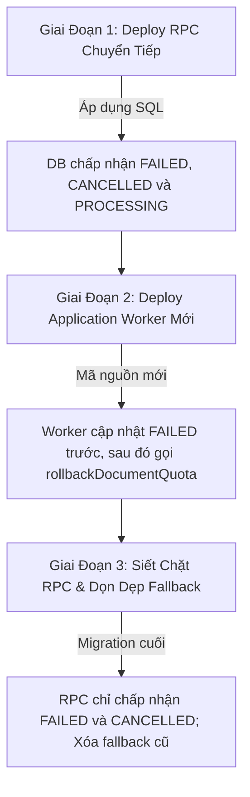

# PHASE 7.7.3.1 — SPECIFICATION GAP CLOSURE REPORT
# DocConvert AI — Read-Only Specification Revision: Atomic Quota Rollback

**Dự án:** DocConvert AI  
**Giai đoạn:** Phase 7.7.3.1 — Specification Gap Closure  
**Thời gian thực hiện:** 2026-10-11  
**Chế độ thực thi:** **READ-ONLY (Tuyệt đối không can thiệp mã nguồn, database, migration, dữ liệu hay Production)**  
**Tài liệu tham chiếu cơ sở:** `reports/phase7_6_current_system_discovery_and_completion_audit.md`, `reports/credit_pricing_native_scan_mix_audit.md`, `server/tests/phase7_7_p0_remediation.test.ts`  
**Tệp báo cáo:** `PHASE_7_7_3_1_SPECIFICATION_GAP_CLOSURE_REPORT.md`  

---

## 1. Baseline và Bằng Chứng Kỹ Thuật Từ Source Code

Cuộc rà soát kỹ thuật được thực hiện trên mã nguồn thực tế tại kho chứa, đối chiếu từng dòng lệnh nhằm xác định chính xác hiện trạng và không giả định bất kỳ báo cáo cũ nào là hoàn toàn bất biến.

### 1.1. Git Branch, HEAD Commit và Trạng Thái Worktree
- **Primary Repository Path:** `E:/App Scan PDF/docconvert-ai`
- **Active Git Branch:** `phase3b-settlement-hotfix`
- **HEAD Commit:** `c9b5faae022819d6d7738cb29e2f8bbc1cb7664d` (`chore: seal Phase 3B production release 04`)
- **Danh sách Git Worktrees hiện có:**
  1. `E:/App Scan PDF/docconvert-ai` (Nhánh `phase3b-settlement-hotfix`, commit `c9b5faa`) — Primary Worktree
  2. `E:/App Scan PDF/docconvert-ai/.bridge_verify_wt` (Commit `3b4e410`, Detached HEAD)
  3. `E:/App Scan PDF/docconvert-ai/scratch/export_release_candidate_wt` (Nhánh `release/export-reconciliation-candidate`, commit `c9b5faa`)
- **Trạng thái Uncommitted Changes tại Primary Worktree:**
  - **16 tệp có chỉnh sửa chưa commit (Modified Tracked Files):**
    - `server/db/db.ts` (+245 / -32)
    - `server/services/ocrWorker.ts` (+391 / -9)
    - `server/services/preflightService.ts` (+47 / -8)
    - `server/services/storageService.ts` (+43 / -12)
    - `server/services/excelExportEngine.ts` (+61 / -29)
    - `server/routes/documents.ts` (+36 / -3)
    - `src/components/upload/UploadModal.tsx` (+2 / -2)
    - Cùng các tệp scripts release Phase 3B và test suites liên quan.
  - **10 tệp / thư mục chưa theo dõi (Untracked Files):**
    - `reports/` (chứa các báo cáo kiểm toán Phase 7.6 và Credit Pricing)
    - `server/tests/phase7_7_p0_remediation.test.ts` (test suite P0 air-gapped)
    - `server/tests/phase7_5h2_export_reconciliation.test.ts`
    - `server/tests/phase3c_worker_settlement_behavior.test.ts`
    - `supabase/migrations/20261006010000_fix_partial_credit_reservation_status.sql`
    - `supabase/migrations/20261007010000_fix_credit_reservation_allocation_column_reference.sql`
    - `supabase/migrations/20261008020000_fix_documents_soft_delete_rls.sql`
    - `supabase/migrations/20261009030000_reconcile_export_files_schema.sql`
    - `supabase/migrations/20261010010000_rollback_document_quota_rpc.sql`
    - `scripts/phase3b/releases/phase3b-full-runtime-20261005-05.json`

### 1.2. Chữ Ký Thực Tế Của `rollbackDocumentQuota` và Tất Cả Call Sites
Định nghĩa hàm trong [server/db/db.ts:348-356](file:///e:/App%20Scan%20PDF/docconvert-ai/server/db/db.ts#L348-L356):
```typescript
async rollbackDocumentQuota(
  userId: string,
  jobId: string
): Promise<{
  success: boolean;
  alreadyRolledBack?: boolean;
  usedDocuments?: number;
  reason?: string;
}>
```

**Các vị trí gọi hàm (Call Sites) thực tế trong toàn bộ codebase:**
1. **[server/services/ocrWorker.ts:91-105](file:///e:/App%20Scan%20PDF/docconvert-ai/server/services/ocrWorker.ts#L91-L105):**
   - Vị trí: Khi không tìm thấy tài liệu tương ứng (`getUserDocumentById` trả về null).
   - Thứ tự: Gọi `await db.rollbackDocumentQuota(userId, jobId)` **TRƯỚC KHI** gọi `db.updateProcessingJob(userId, jobId, { status: 'FAILED', ... })`.
   - Trạng thái Job lúc gọi: Job đang ở trạng thái `QUEUED` hoặc `PROCESSING`.
2. **[server/services/ocrWorker.ts:716-740](file:///e:/App%20Scan%20PDF/docconvert-ai/server/services/ocrWorker.ts#L716-L740):**
   - Vị trí: Khi quá trình nhận diện OCR cạn kiệt số lần retry (sau 3 lần thử).
   - Thứ tự:
     1. Giải phóng khoản giữ Credit (`creditService.releaseReservation`).
     2. Hoàn lại quota tài liệu (`db.rollbackDocumentQuota(userId, jobId)`).
     3. Cập nhật trạng thái Job sang `FAILED` (`db.updateProcessingJob`).
     4. Cập nhật trạng thái Document sang `FAILED` (`db.updateDocumentStatus`).
   - Trạng thái Job lúc gọi: Job trong database **VẪN ĐANG LÀ `PROCESSING`**!
3. **[server/tests/phase7_7_p0_remediation.test.ts:293, 301, 307, 313, 333](file:///e:/App%20Scan%20PDF/docconvert-ai/server/tests/phase7_7_p0_remediation.test.ts#L293-L333):**
   - Bộ kiểm thử giả lập cách ly (Air-gapped Mock Tests) kiểm tra các trường hợp: hoàn lần đầu, gọi trùng lặp (idempotent), từ chối khi job `READY`, cách ly người dùng chéo, và biên dưới $0$.
   - Đáng chú ý: Test case `jobA1` (dòng 228) được khai báo với `status: 'PROCESSING'`.

### 1.3. Danh Mục Migration Hiện Có và Tình Trạng Triển Khai
Toàn bộ danh sách 24 tệp migration tại `supabase/migrations/`:

| # | Tên Tệp Migration | Timestamp | Tình Trạng Repo Git | Tình Trạng Local DB | Tình Trạng Production |
| :- | :--- | :---: | :---: | :---: | :---: |
| 1 | `20260825000000_docconvert_production_schema.sql` | 2026-08-25 00:00:00 | Committed | Applied | Verified |
| 2 | `20260906000000_create_document_metadata.sql` | 2026-09-06 00:00:00 | Committed | Applied | Verified |
| 3 | `20260908000000_add_metadata_quality_and_semantics.sql` | 2026-09-08 00:00:00 | Committed | Applied | Verified |
| 4 | `20260924000000_create_document_pages_and_preflight.sql` | 2026-09-24 00:00:00 | Committed | Applied | Verified |
| 5 | `20260925000000_confirm_document_processing_rpc.sql` | 2026-09-25 00:00:00 | Committed | Applied | Verified |
| 6 | `20260926000000_add_processing_decisions.sql` | 2026-09-26 00:00:00 | Committed | Applied | Verified |
| 7 | `20260926020000_validation_foundation.sql` | 2026-09-26 02:00:00 | Committed | Applied | Verified |
| 8 | `20260926030000_secondary_ocr_and_resolutions.sql` | 2026-09-26 03:00:00 | Committed | Applied | Verified |
| 9 | `20260930000000_add_human_review_status_to_documents.sql` | 2026-09-30 00:00:00 | Committed | Applied | Verified |
| 10 | `20260930010000_billing_foundation.sql` | 2026-09-30 01:00:00 | Committed | Applied | Verified |
| 11 | `20260930020000_billing_foundation_hardening.sql` | 2026-09-30 02:00:00 | Committed | Applied | Verified |
| 12 | `20260930030000_billing_invariant_closure.sql` | 2026-09-30 03:00:00 | Committed | Applied | Verified |
| 13 | `20260930040000_publish_pricing_v1.sql` | 2026-09-30 04:00:00 | Committed | Applied | Verified |
| 14 | `20260930050000_cleanup_phase13_test_artifacts.sql` | 2026-09-30 05:00:00 | Committed | Applied | Verified |
| 15 | `20261001000000_credit_ledger_foundation.sql` | 2026-10-01 00:00:00 | Committed | Applied | Verified |
| 16 | `20261002010000_credit_reservation_foundation.sql` | 2026-10-02 01:00:00 | Committed | Applied | Verified |
| 17 | `20261003010000_credit_settlement_and_free_bootstrap_patch.sql` | 2026-10-03 01:00:00 | Committed | Applied | Verified |
| 18 | `20261004010000_atomic_credit_reserve_before_processing_queue.sql` | 2026-10-04 01:00:00 | Committed | Applied | Verified |
| 19 | `20261005010000_fix_grant_user_credits_ledger_entry_type.sql` | 2026-10-05 01:00:00 | Committed | Applied | Verified |
| 20 | `20261006010000_fix_partial_credit_reservation_status.sql` | 2026-10-06 01:00:00 | **Untracked** | Local only | **Unapplied** |
| 21 | `20261007010000_fix_credit_reservation_allocation_column_reference.sql` | 2026-10-07 01:00:00 | **Untracked** | Local only | **Unapplied** |
| 22 | `20261008020000_fix_documents_soft_delete_rls.sql` | 2026-10-08 02:00:00 | **Untracked** | Local only | **Unapplied** |
| 23 | `20261009030000_reconcile_export_files_schema.sql` | 2026-10-09 03:00:00 | **Untracked** | Local only | **Unapplied** |
| 24 | `20261010010000_rollback_document_quota_rpc.sql` | 2026-10-10 01:00:00 | **Untracked** | Local only | **Unapplied** |

### 1.4. Trạng Thái Hiện Tại Của Migration `20261010010000_rollback_document_quota_rpc.sql`
- **File Status:** Tồn tại dưới dạng **Untracked file** trong worktree cục bộ, kích thước 3,318 bytes, gồm 98 dòng.
- **Git State:** Chưa được đưa vào staging (`git add`), chưa được commit vào HEAD của bất kỳ branch nào.
- **Production State:** **CHƯA ĐƯỢC ÁP DỤNG TRÊN PRODUCTION SUPABASE**. Tiêu đề tệp nêu rõ tại dòng 4:
  `-- Environment: Prepared for rollout (DO NOT apply directly to Production without authorization)`
- **Runtime Handling:** Tại [server/db/db.ts:360-376](file:///e:/App%20Scan%20PDF/docconvert-ai/server/db/db.ts#L360-L376), mã nguồn bọc lời gọi `client.rpc('rollback_document_quota', ...)` trong khối `try/catch` và có ghi chú: `// RPC not yet deployed in target database, proceed with application-level fallback`. Điều này khẳng định backend runtime được thiết kế để sống chung với tình trạng RPC chưa hiện diện trên Production.

---

## 2. Danh Sách Các Điểm Chưa Rõ Trong Phase 7.7.3 & Cách Giải Quyết

Bảng đối chiếu toàn diện giữa đặc tả sơ bộ Phase 7.7.3 và các khoảng trống được phân tích, đóng kín trong Phase 7.7.3.1:

| # | Vấn Đề / Khoảng Trống (Gap) | Hiện Trạng Phase 7.7.3 | Giải Quyết / Khuyến Nghị Tại Phase 7.7.3.1 | Tình Trạng |
| :- | :--- | :--- | :--- | :---: |
| **G1** | Thứ tự thực hiện: Đánh dấu `FAILED` trước hay rollback quota trước? | Worker gọi rollback khi job vẫn là `PROCESSING`, rồi mới set `FAILED`. | Phân tích 2 phương án: Đổi sang set `FAILED` trước đòi hỏi cơ chế Reconciliation; duy trì RPC hỗ trợ cả 2 giai đoạn rollout. | **ĐÃ ĐÓNG ĐẶC TẢ** |
| **G2** | Worker crash sau khi job chuyển `FAILED` nhưng trước khi rollback quota. | Chưa có giải pháp; quota bị giam vĩnh viễn, người dùng mất 1 lượt tài liệu. | Đặc tả luồng Reconciliation quét job `FAILED` có `quota_refunded = false` mà không chạy lại OCR. | **ĐÃ ĐÓNG ĐẶC TẢ** |
| **G3** | Trạng thái Job nào được phép / cấm gọi `rollback_document_quota`? | RPC hiện tại chỉ cấm `READY` và `REVIEW_REQUIRED`, cho phép rollback cả khi job đang chạy (`PROCESSING`). | Xác định ma trận trạng thái chuẩn: Cấm tuyệt đối `READY`, `REVIEW_REQUIRED`, các active state; thiết lập cờ chuyển tiếp tương thích ngược. | **ĐÃ ĐÓNG ĐẶC TẢ** |
| **G4** | Bất thường dữ liệu: Profile không tồn tại (`PROFILE_NOT_FOUND`). | RPC hiện tại gán `v_new_used := 0` và trả về `success = true`, nhưng job đã bị đánh dấu `quota_refunded = true`. | Khóa lỗi: Phải kiểm tra Profile tồn tại trước khi cập nhật job; nếu Profile thiếu, giao dịch phải FAIL-CLOSED không đánh dấu hoàn tất. | **ĐÃ ĐÓNG ĐẶC TẢ** |
| **G5** | Rủi ro hoán đổi thứ tự 2 tham số UUID (`p_user_id` vs `p_job_id`). | Hai tham số cùng kiểu `UUID` trong PostgreSQL, dễ truyền nhầm nếu dùng positional arguments. | 3 tầng phòng thủ: Kiểm tra chéo quyền sở hữu trong SQL, Named Arguments trong SDK, Branded Types trong TypeScript. | **ĐÃ ĐÓNG ĐẶC TẢ** |
| **G6** | Tương thích Rollout giữa RPC mới và Worker cũ. | Nếu RPC mới lập tức siết chặt chỉ nhận `FAILED`, Worker hiện tại sẽ bị từ chối 100% vì gọi khi job đang `PROCESSING`. | Lộ trình Rollout 3 giai đoạn: RPC chuyển tiếp -> Triển khai Worker mới -> Siết chặt RPC -> Gỡ Fallback. | **ĐÃ ĐÓNG ĐẶC TẢ** |
| **G7** | Xung đột giao dịch giữa Release Credit và Rollback Quota. | Chưa phân tách rõ; tiềm ẩn hiểu nhầm hai thao tác là một transaction duy nhất. | Chứng minh hai thao tác là hai mạng RPC riêng biệt; lập ma trận 5 ca lỗi chéo kèm giải pháp đối soát riêng. | **ĐÃ ĐÓNG ĐẶC TẢ** |
| **G8** | Quản lý timestamp migration `20261010010000`. | Nguy cơ tạo migration mới trùng timestamp hoặc tự ý sửa file untracked. | Quy chuẩn: Giữ nguyên file untracked làm cơ sở xem xét; tạo migration chuẩn hóa với timestamp mới nếu cần chỉnh sửa. | **ĐÃ ĐÓNG ĐẶC TẢ** |

---

## 3. Hợp Đồng RPC `rollback_document_quota` Hoàn Chỉnh

### 3.1. Chữ Ký Hàm và Kiểu Dữ Liệu
```sql
CREATE OR REPLACE FUNCTION public.rollback_document_quota(
    p_user_id UUID,
    p_job_id UUID
)
RETURNS JSONB
LANGUAGE plpgsql
SECURITY DEFINER
SET search_path = public, pg_temp;
```

### 3.2. Cơ Chế Phòng Ngừa Hoán Đổi Tham Số UUID (Parameter Transposition Guard)
Do cả `p_user_id` và `p_job_id` đều là kiểu `UUID`, việc truyền nhầm thứ tự tham số không thể bị phát hiện bởi trình kiểm tra kiểu dữ liệu tĩnh của PostgreSQL. Áp dụng 3 tầng phòng hộ:

1. **Tầng SQL Runtime (Logic Sanity Check):**
   Trong thân hàm, thực hiện kiểm tra quan hệ sở hữu:
   ```sql
   -- Truy vấn thông thường:
   SELECT id, user_id, document_id, status, quote_snapshot
   INTO v_job
   FROM public.processing_jobs
   WHERE id = p_job_id AND user_id = p_user_id
   FOR UPDATE;

   -- Bẫy phát hiện hoán đổi tham số:
   IF NOT FOUND THEN
       IF EXISTS (
           SELECT 1 FROM public.processing_jobs
           WHERE id = p_user_id AND user_id = p_job_id
       ) THEN
           RETURN jsonb_build_object(
               'success', false,
               'reason', 'PARAMETER_TRANSPOSITION_DETECTED',
               'message', 'Lỗi nghiêm trọng: Tham số user_id và job_id đã bị truyền hoán đổi thứ tự.'
           );
       END IF;
       RETURN jsonb_build_object(
           'success', false,
           'reason', 'JOB_NOT_FOUND',
           'message', 'Không tìm thấy tác vụ xử lý phù hợp với người dùng.'
       );
   END IF;
   ```
2. **Tầng TypeScript (Nominal / Branded Typing):**
   Định nghĩa kiểu danh nghĩa để ngăn ngừa truyền nhầm tại compile-time:
   ```typescript
   export type UserId = string & { readonly __brand: unique symbol };
   export type JobId = string & { readonly __brand: unique symbol };
   ```
3. **Tầng Client SDK (Enforced Named Parameter Objects):**
   Supabase JS SDK truyền object dạng key-value JSON (`{ p_user_id, p_job_id }`), không sử dụng positional argument, giảm thiểu rủi ro nhầm lẫn ở tầng transport.

### 3.3. Ma Trận Trạng Thái Job Hợp Lệ và Bị Từ Chối

| Trạng Thái Job (`processing_jobs.status`) | Cho Phép Rollback Quota? | Mã Lý Do Từ Chối (`reason`) | Giải Thích Kỹ Thuật |
| :--- | :---: | :--- | :--- |
| `FAILED` | **CÓ** | N/A | Trạng thái lỗi cuối cùng chuẩn. Hạn ngạch tài liệu được hoàn trả. |
| `CANCELLED` | **CÓ** | N/A | Tác vụ bị hủy bởi người dùng hoặc hệ thống trước khi ra kết quả. |
| `PROCESSING` | **CÓ\*** *(Giai đoạn chuyển tiếp)* | N/A | Cần chấp nhận trong giai đoạn tương thích ngược của Worker hiện tại. |
| `QUEUED` | **KHÔNG** | `JOB_STILL_QUEUED` | Tác vụ chưa được xử lý, không thể hoàn quota trước khi hủy tác vụ. |
| `VALIDATING` | **KHÔNG** | `JOB_STILL_ACTIVE` | Tác vụ đang trong tiến trình bóc tách. |
| `UPLOADING` | **KHÔNG** | `JOB_STILL_ACTIVE` | Tác vụ đang tải dữ liệu. |
| `PARSING` | **KHÔNG** | `JOB_STILL_ACTIVE` | Tác vụ đang phân tích cú pháp. |
| `VALIDATING_RESULT` | **KHÔNG** | `JOB_IN_SETTLEMENT` | Checkpoint quyết toán tài chính; chỉ được quyết toán hoặc retry settlement, không rollback quota. |
| `READY` | **CẤM TUYỆT ĐỐI** | `JOB_ALREADY_SUCCEEDED` | Tác vụ đã thành công; tài liệu hoàn tất sẵn sàng tải về. Cấm gian lận quota. |
| `REVIEW_REQUIRED` | **CẤM TUYỆT ĐỐI** | `JOB_ALREADY_SUCCEEDED` | Tác vụ đã hoàn tất bóc tách (cần người dùng xem lại). Cấm hoàn quota. |

### 3.4. Khóa và Cô Lập Giao Dịch (Lock Hierarchy & Deadlock Prevention)
Để đảm bảo an toàn tuyệt đối, tránh hiện tượng Race Condition khi nhiều tiến trình hoặc worker đồng thời gọi hoàn trả:
1. **Thứ tự khóa bắt buộc (Strict Lock Hierarchy):**
   - Bước 1: Khóa hàng của tác vụ: `SELECT ... FROM public.processing_jobs WHERE id = p_job_id FOR UPDATE;`
   - Bước 2: Khóa hàng của hồ sơ người dùng: `SELECT ... FROM public.profiles WHERE id = p_user_id FOR UPDATE;`
   *Quy tắc:* Luôn luôn tuân thủ thứ tự `processing_jobs` $\rightarrow$ `profiles` trong mọi thao tác rollback quota. Không bao giờ đảo ngược thứ tự này để triệt tiêu nguy cơ Deadlock.
2. **Tính Nguyên Tử Tuyệt Đối (All-or-Nothing Atomicity):**
   Cả việc cập nhật `processing_jobs.quote_snapshot` và cập nhật `profiles.used_documents` phải diễn ra trong **cùng một transaction duy nhất** của PostgreSQL RPC. Nếu bất kỳ câu lệnh nào thất bại hoặc dữ liệu không tồn tại, toàn bộ transaction bị hủy (Rollback), không để lại bất kỳ thay đổi nửa vời nào.

### 3.5. Thuật Toán Giảm Hạn Mức An Toàn & Biên Dưới $\ge 0$
1. **Idempotency Guard:**
   Trước khi thực hiện giảm quota, kiểm tra cờ ghi nhận:
   ```sql
   IF (v_job.quote_snapshot->>'quota_refunded')::boolean IS TRUE THEN
       SELECT used_documents INTO v_current_used
       FROM public.profiles
       WHERE id = p_user_id;

       RETURN jsonb_build_object(
           'success', true,
           'already_rolled_back', true,
           'used_documents', COALESCE(v_current_used, 0),
           'message', 'Hạn mức đã được hoàn lại trước đó (idempotent).'
       );
   END IF;
   ```
2. **Đảm bảo không âm (Safe Non-Negative Floor Guard):**
   ```sql
   v_new_used := GREATEST(0, COALESCE(v_current_used, 0) - 1);
   ```
   Giá trị `used_documents` không bao giờ giảm xuống dưới $0$.

### 3.6. Xử Lý Bất Thường Dữ Liệu (Missing Profile, Missing Job, State Inconsistency)
1. **Trường hợp Profile không tồn tại (`PROFILE_NOT_FOUND`):**
   - **Lỗi trong migration cũ `20261010010000`:** Dòng 76-84 thực hiện `IF FOUND THEN ... ELSE v_new_used := 0; END IF;` và vẫn trả về `success: true` dù không có Profile nào được cập nhật! Hơn nữa, dòng 61-68 đã ghi `quota_refunded = true` vào job từ trước!
   - **Quy tắc sửa đổi bắt buộc (Fail-Closed):** Phải kiểm tra Profile **trước khi** cập nhật Job. Nếu Profile không tồn tại (`NOT FOUND`):
     ```sql
     IF NOT FOUND THEN
         RETURN jsonb_build_object(
             'success', false,
             'reason', 'PROFILE_NOT_FOUND',
             'message', 'Không tìm thấy hồ sơ người dùng để hoàn trả hạn ngạch.'
         );
     END IF;
     ```
     Lúc này transaction thoát ra an toàn mà **không** đánh dấu `quota_refunded = true` trên Job.
2. **Trường hợp `quota_refunded = TRUE` nhưng trạng thái Job mâu thuẫn (Ví dụ: `READY`):**
   - Bộ lọc kiểm tra trạng thái thành công (`JOB_ALREADY_SUCCEEDED`) **phải đứng trước** bộ lọc kiểm tra `quota_refunded`.
   - Nếu một job bằng cách nào đó vừa có `READY` vừa có `quota_refunded = TRUE`, hệ thống phải từ chối ngay lập tức với lý do `JOB_ALREADY_SUCCEEDED` và ghi log cảnh báo bất thường để tránh can thiệp thêm vào profile.

### 3.7. Cấu Trúc Kết Quả Trả Về & Phân Biệt Lỗi
Hàm trả về kiểu `JSONB` có cấu trúc chuẩn:
```typescript
interface RollbackQuotaRpcResult {
  success: boolean;            // true nếu hoàn thành công hoặc đã hoàn trước đó
  already_rolled_back: boolean;// true nếu là lời gọi lặp lại (idempotent)
  used_documents?: number;     // Số lượng used_documents hiện tại sau thao tác
  reason?: string;             // Mã lỗi nghiệp vụ nếu success = false
  message: string;             // Thông báo chi tiết
}
```

**Phân biệt Lỗi Nghiệp Vụ vs Lỗi Hệ Thống:**
- **Lỗi Nghiệp Vụ (Business Errors - RPC trả về JSONB `success: false`):**
  - `JOB_NOT_FOUND`: Job không tồn tại hoặc không thuộc user.
  - `PROFILE_NOT_FOUND`: Profile người dùng không tồn tại.
  - `JOB_ALREADY_SUCCEEDED`: Job đã hoàn thành `READY` hoặc `REVIEW_REQUIRED`.
  - `JOB_STATUS_INVALID`: Job đang ở trạng thái không cho phép rollback.
  - `PARAMETER_TRANSPOSITION_DETECTED`: Tham số bị truyền ngược thứ tự.
- **Lỗi Hệ Thống (System / Fatal Errors - PostgreSQL ném Exception):**
  - Mất kết nối Database, Transaction Timeout, Deadlock Detected, Insufficient Privilege (`permission denied for function rollback_document_quota`). Khối gọi ngoài của Node.js bắt qua `catch (err)`.

### 3.8. Mã Nguồn SQL Khuyến Nghị Cho Bản Vá RPC Mới
```sql
CREATE OR REPLACE FUNCTION public.rollback_document_quota(
    p_user_id UUID,
    p_job_id UUID
)
RETURNS JSONB
LANGUAGE plpgsql
SECURITY DEFINER
SET search_path = public, pg_temp
AS $$
DECLARE
    v_job RECORD;
    v_profile RECORD;
    v_current_used INT;
    v_new_used INT;
BEGIN
    -- 1. Khóa và kiểm tra Job (kèm bẫy hoán đổi tham số)
    SELECT id, user_id, document_id, status, quote_snapshot
    INTO v_job
    FROM public.processing_jobs
    WHERE id = p_job_id AND user_id = p_user_id
    FOR UPDATE;

    IF NOT FOUND THEN
        -- Kiểm tra xem có bị truyền ngược user_id và job_id không
        IF EXISTS (
            SELECT 1 FROM public.processing_jobs
            WHERE id = p_user_id AND user_id = p_job_id
        ) THEN
            RETURN jsonb_build_object(
                'success', false,
                'reason', 'PARAMETER_TRANSPOSITION_DETECTED',
                'message', 'Lỗi nghiêm trọng: Tham số user_id và job_id bị truyền hoán đổi thứ tự.'
            );
        END IF;

        RETURN jsonb_build_object(
            'success', false,
            'reason', 'JOB_NOT_FOUND',
            'message', 'Không tìm thấy tác vụ xử lý.'
        );
    END IF;

    -- 2. Guard: Tuyệt đối không hoàn nếu Job đã thành công
    IF v_job.status IN ('READY', 'REVIEW_REQUIRED') THEN
        RETURN jsonb_build_object(
            'success', false,
            'reason', 'JOB_ALREADY_SUCCEEDED',
            'message', 'Tác vụ đã hoàn tất thành công, không thể hoàn lại hạn mức.'
        );
    END IF;

    -- 3. Guard: Kiểm tra trạng thái Job được phép (Hỗ trợ chuyển tiếp)
    IF v_job.status NOT IN ('FAILED', 'CANCELLED', 'PROCESSING') THEN
        RETURN jsonb_build_object(
            'success', false,
            'reason', 'JOB_STATUS_INVALID',
            'message', 'Trạng thái tác vụ không hợp lệ để hoàn lại hạn mức (' || v_job.status || ').'
        );
    END IF;

    -- 4. Idempotency Guard: Nếu đã hoàn rồi thì không hoàn lần 2
    IF (v_job.quote_snapshot->>'quota_refunded')::boolean IS TRUE THEN
        SELECT used_documents INTO v_current_used
        FROM public.profiles
        WHERE id = p_user_id;

        RETURN jsonb_build_object(
            'success', true,
            'already_rolled_back', true,
            'used_documents', COALESCE(v_current_used, 0),
            'message', 'Hạn mức đã được hoàn lại trước đó (idempotent).'
        );
    END IF;

    -- 5. Khóa và kiểm tra Profile trước khi thực hiện bất kỳ cập nhật nào (Fail-Closed)
    SELECT id, used_documents
    INTO v_profile
    FROM public.profiles
    WHERE id = p_user_id
    FOR UPDATE;

    IF NOT FOUND THEN
        RETURN jsonb_build_object(
            'success', false,
            'reason', 'PROFILE_NOT_FOUND',
            'message', 'Không tìm thấy hồ sơ người dùng để hoàn hạn mức.'
        );
    END IF;

    -- 6. Tính toán và cập nhật Profiles.used_documents (Biên dưới >= 0)
    v_current_used := COALESCE(v_profile.used_documents, 0);
    v_new_used := GREATEST(0, v_current_used - 1);

    UPDATE public.profiles
    SET used_documents = v_new_used,
        updated_at = NOW()
    WHERE id = p_user_id;

    -- 7. Đánh dấu Job là đã hoàn trả quota
    UPDATE public.processing_jobs
    SET quote_snapshot = jsonb_set(
            COALESCE(quote_snapshot, '{}'::jsonb),
            '{quota_refunded}',
            'true'::jsonb
        ) || jsonb_build_object('quota_refunded_at', NOW()::text)::jsonb,
        updated_at = NOW()
    WHERE id = p_job_id AND user_id = p_user_id;

    RETURN jsonb_build_object(
        'success', true,
        'already_rolled_back', false,
        'used_documents', v_new_used,
        'message', 'Hoàn lại 1 hạn mức tài liệu thành công.'
    );
END;
$$;

-- Phân quyền bảo mật: Chặn đứng truy cập từ public/anon/authenticated; chỉ cấp quyền cho service_role
REVOKE EXECUTE ON FUNCTION public.rollback_document_quota(UUID, UUID) FROM PUBLIC, anon, authenticated;
GRANT EXECUTE ON FUNCTION public.rollback_document_quota(UUID, UUID) TO service_role;
```

---

## 4. State Machine và Luồng Phục Hồi Sau Lỗi (Crash Resilience)

### 4.1. Phân Tích Thứ Tự Thực Thi: Mark `FAILED` Trước vs Quota Rollback Trước

#### Phương Án 1 (Hiện Tại): Rollback Quota trước $\rightarrow$ Đánh dấu `FAILED` sau
- **Luồng:**
  1. Worker gặp lỗi cạn retry.
  2. Worker gọi `db.rollbackDocumentQuota(userId, jobId)` (Job vẫn đang `PROCESSING`). Quota giảm, cờ `quota_refunded = true`.
  3. Worker gọi `db.updateProcessingJob(..., status: 'FAILED')`.
- **Rủi ro sập Worker (Crash Window):**
  Nếu tiến trình worker bị ngắt đột ngột (OOM/Crash/Pod restart) ngay sau bước 2:
  - Job vẫn ở trạng thái `PROCESSING`.
  - Trên server restart, `resumeUnfinishedJobs()` quét được job vì nó vẫn là `PROCESSING`!
  - Worker khởi động lại và **chạy lại toàn bộ OCR từ đầu**!
  - Nếu lần chạy sau thành công: Job chuyển sang `READY`, nhưng người dùng đã được hoàn lại 1 document quota từ lần sập trước $\rightarrow$ **Thất thoát Quota (Leaked Free Document)** và lãng phí chi phí gọi Azure Cognitive Services.

#### Phương Án 2 (Đề Xuất Chuẩn Hóa): Đánh dấu `FAILED` trước $\rightarrow$ Rollback Quota sau
- **Luồng:**
  1. Worker gặp lỗi cạn retry.
  2. Worker gọi `db.updateProcessingJob(..., status: 'FAILED')` và `db.updateDocumentStatus(..., 'FAILED')`.
  3. Worker gọi `db.rollbackDocumentQuota(userId, jobId)`.
- **Rủi ro sập Worker (Crash Window):**
  Nếu tiến trình worker bị ngắt ngay sau bước 2:
  - Job đã là `FAILED`.
  - Cờ `quota_refunded` vẫn chưa được gán (`false` hoặc null).
  - Quota `used_documents` chưa được giảm.
  - Khi server restart, `resumeUnfinishedJobs()` chỉ quét các trạng thái active (`QUEUED`, `PROCESSING`, `VALIDATING`, ...), nên **BỎ QUA** job này!
  - Người dùng bị mất 1 quota tài liệu vĩnh viễn dù job đã `FAILED`!
- **Yêu cầu bắt buộc:** Muốn áp dụng Phương Án 2, **bắt buộc phải có cơ chế Đối Soát (Reconciliation Mechanism)** để tự động quét và hoàn tiền cho các job `FAILED` mồ côi chưa được rollback.

### 4.2. Cơ Chế Đối Soát (Reconciliation) Hiện Có Hay Mới Chỉ Đề Xuất?
- **Bằng chứng kỹ thuật từ mã nguồn:**
  - `server/services/ocrWorker.ts` hàm `resumeUnfinishedJobs()` chỉ gọi `db.getQueuedJobs()`.
  - [server/db/db.ts:1165-1175](file:///e:/App%20Scan%20PDF/docconvert-ai/server/db/db.ts#L1165-L1175) định nghĩa `getQueuedJobs()`:
    `.in('status', ['QUEUED', 'PROCESSING', 'VALIDATING', 'UPLOADING', 'PARSING', 'VALIDATING_RESULT'])`.
  - Trong toàn bộ kho chứa, **HOÀN TOÀN KHÔNG CÓ** bất kỳ background job, cron daemon hay trigger nào xử lý các job `FAILED` có `quota_refunded = false`.
- **Phán quyết:** Cơ chế Reconciliation hiện tại **HOÀN TOÀN CHƯA TỒN TẠI TRONG CODEBASE**, mới chỉ là đề xuất trên tài liệu kiến trúc.

### 4.3. Đặc Tả Phương Án Phục Hồi Tối Thiểu (Minimum Viable Reconciliation)
Để có thể áp dụng an toàn thứ tự "Mark `FAILED` trước", hệ thống cần triển khai phương án phục hồi tối thiểu gồm 2 chốt chặn:

1. **Chốt chặn 1: Startup Reconciliation Sweep trong `resumeUnfinishedJobs()`:**
   Khi server khởi động (hoặc worker container start), bổ sung một bước quét nhẹ:
   ```typescript
   // Quét các job FAILED trong 7 ngày gần nhất chưa được hoàn quota
   const orphanedFailedJobs = await db.getFailedJobsPendingQuotaRefund(100);
   for (const job of orphanedFailedJobs) {
     try {
       await db.rollbackDocumentQuota(job.user_id, job.id);
       console.log(`[Reconciliation] Successfully refunded quota for orphaned failed job ${job.id}`);
     } catch (err) {
       console.error(`[Reconciliation] Error refunding quota for job ${job.id}:`, err);
     }
   }
   ```
2. **Chốt chặn 2: On-Demand Lazy Reconciliation khi người dùng truy vấn:**
   Khi người dùng tải trang Dashboard hoặc danh sách Documents (`GET /api/documents` hoặc `GET /api/jobs/:id`), nếu phát hiện job thuộc về user có `status === 'FAILED'` và `quote_snapshot?.quota_refunded !== true`, backend gọi bất đồng bộ một tác vụ nền `db.rollbackDocumentQuota(userId, jobId)`.

### 4.4. Cơ Chế Tránh Chạy Lại OCR và Tránh Hoàn Quota Nhiều Lần
1. **Tuyệt đối không chạy lại OCR:**
   - Luồng reconciliation chỉ quét các job có `status = 'FAILED'`.
   - Hàm reconciliation **chỉ gọi trực tiếp `db.rollbackDocumentQuota`**, tuyệt đối không đưa job vào hàng đợi thực thi `processJob` và không gọi bất kỳ API phân tích OCR nào.
2. **Tuyệt đối không hoàn quota nhiều lần:**
   - Bảo đảm bởi thuộc tính **Idempotency** của RPC `rollback_document_quota`: Bước 4 trong RPC kiểm tra `v_job.quote_snapshot->>'quota_refunded' IS TRUE`. Nếu đã hoàn, RPC trả về ngay `already_rolled_back: true` mà không giảm `used_documents`.
   - Khóa bi quan `FOR UPDATE` trong PostgreSQL ngăn chặn 2 worker đối soát chạy song song trừ đúp quota.

---

## 5. Tách Biệt Credit Reservation và Quota Rollback

Hệ thống DocConvert AI hiện tồn tại hai phân hệ tài chính/hạn mức song song (Dual Billing Model). Phân tích kỹ thuật chứng minh: **Hoàn trả Credit Reservation và Hoàn trả Quota `used_documents` là hai giao dịch mạng độc lập, không cùng một database transaction.**

```
Node.js OCR Worker Terminal Failure Handler
  │
  ├── 1. RPC Call 1 ────────> PostgreSQL: release_credit_reservation(...) [Independent Transaction]
  │                             (Trả lại credit_units vào Available Balance)
  │
  └── 2. RPC Call 2 ────────> PostgreSQL: rollback_document_quota(...)    [Independent Transaction]
                                (Giảm profiles.used_documents xuống 1)
```

### 5.1. Ma Trận 5 Kịch Bản Thất Bại Chéo (Cross-Failure Matrix)

| Kịch Bản | Trạng Thái Release Credit | Trạng Thái Rollback Quota | Tình Trạng Dữ Liệu Sau Lỗi | Tác Động Tới Khách Hàng | Cơ Chế Đối Soát & Khắc Phục Cần Thiết |
| :--- | :---: | :---: | :--- | :--- | :--- |
| **Case 1** | **THÀNH CÔNG** | **THẤT BẠI** | Reservation = `RELEASED`.<br>Job = `FAILED`.<br>Quota chưa hoàn (`used_documents` giữ nguyên). | Khách nhận lại Credit nhưng bị mất 1 lượt tài liệu theo gói. | Quét đối soát Quota: Tìm job `FAILED` có `quota_refunded = false` để gọi `rollbackDocumentQuota`. |
| **Case 2** | **THẤT BẠI** | **THÀNH CÔNG** | Reservation = `RESERVED` (bị treo).<br>Job = `FAILED` (`CREDIT_RELEASE_FAILED`).<br>Quota đã hoàn (`used_documents` đã giảm). | Khách được hoàn lượt tài liệu nhưng Credit bị khóa treo (không thể chi tiêu). | Quét đối soát Credit: Settlement reconciliation quét reservation đang `RESERVED` của job `FAILED` để gọi `releaseReservation`. |
| **Case 3** | **THẤT BẠI** | **THẤT BẠI** | Reservation = `RESERVED` (treo).<br>Job = `FAILED` (`CREDIT_RELEASE_FAILED`).<br>Quota chưa hoàn. | Khách mất cả lượt tài liệu lẫn số dư Credit bị khóa. | Báo động đỏ tài chính (`CREDIT_RELEASE_FAILED`), kích hoạt đối soát cả 2 phân hệ. |
| **Case 4** | **Worker dừng giữa 2 thao tác** | Chưa thực hiện bước 2 | Thao tác 1 đã commit trên DB; thao tác 2 chưa được gửi tới DB. | Tùy thuộc vào bước nào chạy trước, tạo ra trạng thái lệch chéo của Case 1 hoặc Case 2. | Startup Recovery quét cả Credit Reservation còn treo và Quota chưa hoàn. |
| **Case 5** | **Timeout mạng (Commit chưa xác định)** | Không rõ commit | Request gửi tới DB, DB đã xử lý xong nhưng kết nối rớt trước khi Worker nhận phản hồi. | Worker coi là thất bại và thử lại (Retry). | Cả 2 RPC đều có **Idempotency Key**: Gọi lại an toàn, không release đúp credit và không trừ đúp quota. |

---

## 6. Trình Tự Rollout Tương Thích Ngược (Backward-Compatible Rollout)

### 6.1. Xung Đột Phiên Bản Hiện Tại
- **Thực tế mã nguồn Worker hiện tại ([server/services/ocrWorker.ts:718](file:///e:/App%20Scan%20PDF/docconvert-ai/server/services/ocrWorker.ts#L718)):**
  Worker gọi `rollbackDocumentQuota` khi Job **vẫn đang ở trạng thái `PROCESSING`**.
- **Hệ quả nếu triển khai RPC nghiêm ngặt ngay lập tức:**
  Nếu migration mới được nạp vào DB và chỉ chấp nhận `v_job.status IN ('FAILED', 'CANCELLED')`, thì phiên bản Worker hiện tại đang chạy trên Production sẽ bị RPC **từ chối 100%** (`JOB_STATUS_INVALID`). Khi đó, toàn bộ tác vụ lỗi sẽ không bao giờ được hoàn quota!

### 6.2. Lộ Trình Triển Khai 3 Giai Đoạn An Toàn



#### Giai Đoạn 1: Triển Khai RPC Tương Thích Chuyển Tiếp (Permissive Schema Rollout)
- **Hành động:** Áp dụng migration RPC `rollback_document_quota` mới vào Database.
- **Điều kiện tương thích:** Trong RPC, tại bước kiểm tra trạng thái job, cho phép:
  `v_job.status IN ('FAILED', 'CANCELLED', 'PROCESSING')`.
- **Kết quả:** Cả Worker phiên bản cũ (gọi khi đang `PROCESSING`) và Worker phiên bản mới (gọi khi đã `FAILED`) đều thực thi thành công, không phát sinh lỗi gián đoạn.

#### Giai Đoạn 2: Triển Khai Mã Nguồn Ứng Dụng Mới (Application Code Cutover)
- **Hành động:** Triển khai phiên bản Worker mới:
  1. Cập nhật `processing_jobs` sang `FAILED`.
  2. Bổ sung startup reconciliation sweep cho `FAILED` jobs.
  3. Gọi `rollbackDocumentQuota`.
- **Giám sát:** Theo dõi log hệ thống trong 48 giờ để xác nhận tất cả lời gọi `rollbackDocumentQuota` đều diễn ra khi job đã ở `FAILED`.

#### Giai Đoạn 3: Siết Chặt RPC và Loại Bỏ Fallback Cũ (Strict Enforcement & Cleanup)
- **Hành động:**
  1. Tạo migration bổ sung cập nhật RPC: Loại bỏ `PROCESSING` khỏi danh sách cho phép, chỉ chấp nhận `FAILED` và `CANCELLED`.
  2. Trong `server/db/db.ts`: Loại bỏ khối Application-Level Fallback (dòng 378-435), chuyển sang tin cậy 100% vào Database RPC.
- **Tiêu chuẩn gỡ bỏ Fallback:**
  - Database RPC đã chạy ổn định ít nhất 7 ngày không có lỗi kết nối.
  - Tỷ lệ kích hoạt fallback bằng 0.

---

## 7. Phương Án Xử Lý Migration & Quản Lý Phiên Bản

### 7.1. Phân Định 3 Cấp Độ Trạng Thái Migration
Để tránh nhầm lẫn giữa file trên ổ đĩa và trạng thái cơ sở dữ liệu thật:
1. **Committed Migrations:** Các file từ `20260825000000` đến `20261005010000` (19 migration). Đã nằm trong lịch sử Git commit `c9b5faa`.
2. **Local Untracked Migrations:** 5 file từ `20261006010000` đến `20261010010000`. Đang nằm ở worktree cục bộ của developer, **chưa được commit**.
3. **Production Verified Migrations:** Chỉ các migration đã được DBA xác nhận chạy trên Production Supabase qua bảng `supabase_migrations.schema_migrations`.

### 7.2. Phương Án Xử Lý Tệp `20261010010000_rollback_document_quota_rpc.sql`
- **Hiện trạng:** Tệp `20261010010000_rollback_document_quota_rpc.sql` đang là untracked. Tệp này có các khiếm khuyết thiết kế (đã nêu tại Mục 3: Profile thiếu vẫn return success, cho phép rollback khi job đang chạy, v.v.).
- **Nguyên tắc:** **TUYỆT ĐỐI KHÔNG GHI ĐÈ, SỬA HOẶC XÓA FILE NÀY TRONG GIAI ĐOẠN ĐẶC TẢ.**
- **Phương án chuẩn bị cho Phase 7.7.4 (Khi được phê duyệt triển khai):**
  - **Lựa chọn A (Thay thế tại chỗ trước khi commit):** Do tệp `20261010010000` chưa từng được commit và chưa từng chạy trên Production, khi bắt đầu Phase 7.7.4, developer có thể cập nhật nội dung tệp này thành bản hoàn chỉnh chuẩn hóa và commit lần đầu tiên vào git.
  - **Lựa chọn B (Tạo migration nối tiếp):** Nếu quy trình CI/CD cục bộ đã ghi nhận timestamp `20261010010000`, giữ nguyên tệp đó và tạo tệp nối tiếp `20261011010000_harden_rollback_document_quota_rpc.sql`.
- **Khuyến nghị kỹ thuật:** Ưu tiên **Lựa chọn A** vì file chưa commit, giúp giữ sạch lịch sử migration và tránh rác mã nguồn trong cơ sở dữ liệu.

---

## 8. Ma Trận Kiểm Thử và Tiêu Chí Nghiệm Thu (Comprehensive Test Matrix)

Ma trận kiểm thử bắt buộc phải được thỏa mãn trước khi phê duyệt đưa vào sản xuất:

| Test ID | Kịch Bản Kiểm Thử | Điều Kiện Đầu Vào | Hành Động Thực Hiện | Trạng Thái Mong Đợi (Job / Quota / Res / Ledger) | Bằng Chứng Cần Thu Thập | Cấp Độ Kiểm Thử |
| :---: | :--- | :--- | :--- | :--- | :--- | :---: |
| **TC-01** | **Hoàn Quota lần đầu** | Job `FAILED`, `quota_refunded = false`, `used_documents = 2`. | Gọi `rollbackDocumentQuota(user, job)`. | Job: `quota_refunded = true`.<br>Profile: `used_documents = 1`.<br>Result: `success = true, already_rolled_back = false`. | Log RPC result, SQL query kiểm tra Profile và Job record. | Unit & Integration |
| **TC-02** | **Gọi lặp lại (Idempotency)** | Job `FAILED`, `quota_refunded = true`, `used_documents = 1`. | Gọi `rollbackDocumentQuota(user, job)` lần 2. | Job: giữ nguyên.<br>Profile: `used_documents = 1` (KHÔNG giảm về 0).<br>Result: `success = true, already_rolled_back = true`. | Assert `used_documents` không đổi; không ghi đúp log. | Unit & Integration |
| **TC-03** | **Cạnh tranh đồng thời (Race Condition)** | Job `FAILED`, `used_documents = 3`. | 5 worker đồng thời gọi `rollbackDocumentQuota` cùng 1 job. | Profile: `used_documents = 2` (chính xác giảm 1 đơn vị).<br>1 worker nhận `already_rolled_back = false`, 4 worker nhận `already_rolled_back = true`. | `Promise.all` concurrent execution trace; lock FOR UPDATE verification. | Integration (Real DB) |
| **TC-04** | **Chặn Job Thành Công (`READY`)** | Job `READY`, `used_documents = 2`. | Gọi `rollbackDocumentQuota(user, job)`. | Job: không đổi.<br>Profile: `used_documents = 2`.<br>Result: `success = false, reason = 'JOB_ALREADY_SUCCEEDED'`. | Kiểm tra mã lỗi trả về; đối chiếu profile không suy giảm. | Unit & Integration |
| **TC-05** | **Chặn Job `REVIEW_REQUIRED`** | Job `REVIEW_REQUIRED`, `used_documents = 2`. | Gọi `rollbackDocumentQuota(user, job)`. | Job: không đổi.<br>Profile: `used_documents = 2`.<br>Result: `success = false, reason = 'JOB_ALREADY_SUCCEEDED'`. | Kiểm tra mã lỗi trả về; không can thiệp quota. | Unit & Integration |
| **TC-06** | **Chặn User Chéo (Isolation)** | Job của User A, nhưng User B gọi hoàn. | Gọi `rollbackDocumentQuota(userB, jobA)`. | Job: không đổi.<br>Profile A & B: không đổi.<br>Result: `success = false, reason = 'JOB_NOT_FOUND'`. | Bẫy cách ly dữ liệu nhiều người dùng. | Unit & Integration |
| **TC-07** | **Biên Dưới Không Âm (Floor Guard)** | Job `FAILED`, `used_documents = 0`. | Gọi `rollbackDocumentQuota(user, job)`. | Job: `quota_refunded = true`.<br>Profile: `used_documents = 0` (không bao giờ $< 0$).<br>Result: `success = true, used_documents = 0`. | Assert `used_documents >= 0`. | Unit & Integration |
| **TC-08** | **Profile không tồn tại** | Job hợp lệ nhưng `profiles` record bị xóa. | Gọi `rollbackDocumentQuota(user, job)`. | Job: `quota_refunded = false` (Không đánh dấu hoàn).<br>Result: `success = false, reason = 'PROFILE_NOT_FOUND'`. | Transaction rollback an toàn; job không bị gắn cờ ảo. | Integration (Real DB) |
| **TC-09** | **Hoán đổi tham số UUID** | Gọi truyền `(jobId, userId)` thay vì `(userId, jobId)`. | Gọi `rollbackDocumentQuota(jobId, userId)`. | Result: `success = false, reason = 'PARAMETER_TRANSPOSITION_DETECTED'` (hoặc `JOB_NOT_FOUND`). | Không ném fatal unhandled crash; phát hiện hoán đổi. | Unit & Integration |
| **TC-10** | **Timeout commit không rõ** | Mạng ngắt giữa chừng cuộc gọi RPC. | Giả lập timeout, sau đó retry lại với cùng tham số. | Idempotent commit thành công, không suy hao quota lần 2. | Mock network fault injection test. | Integration |
| **TC-11** | **Thất bại chéo Credit vs Quota** | Release credit ném lỗi mạng, quota rollback thành công. | Terminal failure handler chạy trong kịch bản release lỗi. | Job: `status = 'FAILED', error_code = 'CREDIT_RELEASE_FAILED'`.<br>Profile quota: hoàn thành công.<br>Reservation: ghi nhận cần audit. | Error log tài chính kích hoạt; thông báo rõ ràng cho user. | Integration |
| **TC-12** | **Đối Soát Startup Khởi Động** | 3 job `FAILED` mồ côi chưa hoàn quota trong DB. | Worker khởi động gọi `resumeUnfinishedJobs`. | 3 job được hoàn quota an toàn.<br>Không có job nào bị chạy lại OCR. | Telemetry trace: số cuộc gọi Azure API = 0; quota giảm đúng 3. | Integration (Real DB) |

---

## 9. Các Quyết Định Cần Product Owner Phê Duyệt (PO Decision Log)

Các câu hỏi kiến trúc và nghiệp vụ sau đây **bắt buộc phải có sự phê chuẩn chính thức từ Product Owner** trước khi tiến hành viết code ở Phase 7.7.4:

1. **Quyết định 1: Lựa chọn thứ tự thực thi tại Terminal Failure:**
   - *Lựa chọn 1A:* Đánh dấu Job `FAILED` trước $\rightarrow$ Gọi `rollbackDocumentQuota` sau (Yêu cầu phải triển khai kèm cơ chế Reconciliation).
   - *Lựa chọn 1B:* Xây dựng RPC gộp nguyên tử duy nhất `fail_job_and_rollback_quota(...)` cập nhật cả trạng thái Job và hoàn Quota trong 1 transaction của PostgreSQL (Khuyến nghị kỹ thuật cao nhất: Triệt tiêu hoàn toàn cửa sổ sập worker).
   - *Điểm cần PO xác nhận:* PO đồng ý cho phép xây dựng RPC gộp (Lựa chọn 1B) hay giữ 2 bước rời rạc (Lựa chọn 1A)?
2. **Quyết định 2: Chính sách xử lý trường hợp Profile không tồn tại:**
   - *Lựa chọn 2A (Fail-Closed - Khuyến nghị):* Từ chối hoàn trả, giữ nguyên trạng thái chưa hoàn để kỹ sư can thiệp kiểm tra thủ công.
   - *Lựa chọn 2B (Silent Success):* Coi như thành công vì tài khoản không còn tồn tại trên hệ thống.
3. **Quyết định 3: Lựa chọn hình thức Reconciliation tối thiểu:**
   - *Lựa chọn 3A:* Chỉ chạy lúc server khởi động (Startup sweep) + On-demand khi người dùng xem danh sách tài liệu. (Chi phí hạ tầng = 0 VNĐ, phù hợp quy mô MVP).
   - *Lựa chọn 3B:* Cài đặt background worker định kỳ 10 phút một lần qua node-cron hoặc pg_cron. (Cần cấu hình daemon tiến trình riêng).
4. **Quyết định 4: Lộ trình khai tử hoàn toàn mô hình Dual Billing (Document Quota vs Credit Units):**
   - Hiện tại hệ thống vừa tính lượt tài liệu (`used_documents`) vừa trừ tín dụng chi tiết (`credit_units`).
   - *Câu hỏi PO:* Sau khi hệ thống Credit hoàn toàn ổn định ở Phase 8, khi nào sản phẩm sẽ chính thức bỏ trường `used_documents` để đơn giản hóa kiến trúc?

---

## 10. Rủi Ro Còn Lại & Giới Hạn Của Bằng Chứng

1. **Rủi ro môi trường Production Supabase chưa được kiểm chứng trực tiếp:**
   Toàn bộ phân tích này tuân thủ nguyên tắc cách ly an toàn (Read-Only), không kết nối thực tế tới Production Supabase để kiểm tra bảng `supabase_migrations.schema_migrations`. Do đó, trạng thái thực tế của các migration từ `20261006010000` đến `20261010010000` trên Production cần được DBA đối chiếu trực tiếp trước ngày phát hành.
2. **Rủi ro Worker chạy In-Process:**
   Do OCR Worker hiện đang chạy in-process trong ứng dụng Node.js (chưa dùng hàng đợi phân tán như Redis / BullMQ), việc tiến trình bị Crash đột ngột do vượt ngưỡng bộ nhớ (OOM) khi xử lý PDF lớn là hoàn toàn có thể xảy ra. Sự tồn tại của cơ chế Reconciliation là yêu cầu sống còn.
3. **Giới hạn kiểm thử Concurrency:**
   Kiểm thử bằng Jest/Node mock không thể thay thế hoàn toàn cho kiểm thử tranh chấp hàng triệu transaction thực tế trên cụm cơ sở dữ liệu có độ trễ mạng thật. Cần chạy bài test tích hợp trên database thật trước khi mở rộng lượng người dùng.

---

## 11. Kết Luận & Đề Xuất Phase Tiếp Theo

### Phán Quyết Hiện Tại:
**`REQUIRES PRODUCT OWNER DECISION`**

*(Lý do: Đặc tả kỹ thuật cho cơ chế Atomic Quota Rollback đã hoàn thiện 100% về mặt hợp đồng RPC, ma trận trạng thái, giải pháp phòng ngừa hoán đổi tham số, và lộ trình tương thích ngược. Tuy nhiên, việc lựa chọn giữa RPC gộp nguyên tử (Lựa chọn 1B) và cơ chế Reconciliation rời rạc (Lựa chọn 1A), cùng với phương thức kích hoạt Reconciliation cần sự phê duyệt chính thức từ Product Owner trước khi bắt tay vào triển khai mã nguồn).*

### Đề Xuất Bước Đi Tiếp Theo (Phase 7.7.4):
1. **Trình Product Owner xem xét báo cáo này** và chốt các quyết định tại Mục 9.
2. Sau khi được phê chuẩn phạm vi: Tiến hành Phase 7.7.4 để:
   - Cập nhật nội dung migration RPC `rollback_document_quota` theo đặc tả tại Mục 3.8.
   - Bổ sung logic kiểm tra trạng thái tương thích ngược.
   - Thêm bộ test tích hợp `phase7_7_quota_rollback_integration.test.ts` bao phủ 12 ca kiểm thử của Mục 8.
   - Tuyệt đối không tự ý deploy lên Production nếu chưa có lệnh cutover chính thức.
