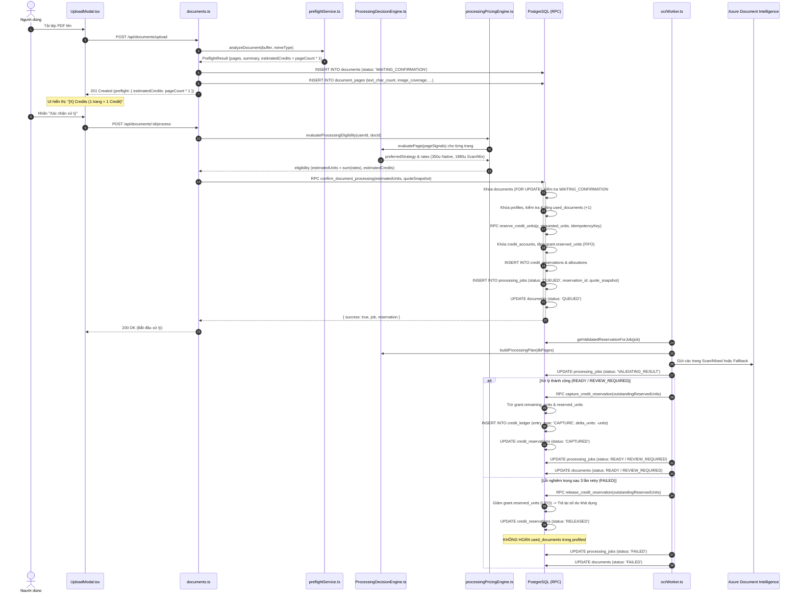

# Báo Cáo Kiểm Toán Khám Phá Hệ Thống, Ánh Xạ Kiến Trúc & Công Việc Chưa Hoàn Tất (Phase 7.6)
# Phase 7.6: Current System Discovery, Architecture Mapping & Incomplete Work Audit

**Dự án:** DocConvert AI  
**Giai đoạn:** Phase 7.6 — Discovery & Incomplete Work Audit  
**Thời gian thực hiện:** 2026-10-10  
**Vai trò kiểm toán:** Principal Software Architect, Senior Full-Stack Engineer, Billing and Ledger Engineer, OCR Pipeline Engineer, Technical Auditor  
**Chế độ thực thi:** **READ-ONLY (Tuyệt đối không can thiệp mã nguồn, database, storage, hay môi trường Production)**  
**Đường dẫn tài liệu:** `reports/phase7_6_current_system_discovery_and_completion_audit.md`  

---

## 1. Executive Summary

DocConvert AI là một ứng dụng SaaS chuyên sâu về bóc tách, chuẩn hóa dữ liệu bảng biểu tài chính (đặc biệt là sao kê ngân hàng) từ tệp PDF/hình ảnh và xuất ra tệp Excel (.xlsx). Hệ thống đã phát triển qua nhiều giai đoạn lớn (từ Phase 1 đến Phase 7.5 và Phase 8), xây dựng nên một kiến trúc backend có độ phức tạp cao với nhiều phân hệ cốt lõi:
- **Preflight & Processing Decision Engine (PDE):** Phân tích hình học và cấu trúc PDF cục bộ không tốn chi phí API, định tuyến chiến lược từng trang (`LOCAL_NATIVE`, `AZURE_FULL_PAGE`, `HYBRID`, `AZURE_FALLBACK`).
- **Core Financial & Reservation Ledger:** Hệ thống sổ cái tài chính số nguyên an toàn (`credit_units`), bảo đảm tính bất biến tài chính với quy trình 2 pha: Khóa giữ trước nguyên tử trước khi vào hàng đợi (`reserve_credit_units`) và Quyết toán thực tế sau khi xử lý (`capture_credit_reservation` / `release_credit_reservation`).
- **Review Workspace & Validation Engine:** Trình biên tập bảng biểu tương tác cao (OcrReviewWorkspace 115 KB), kiểm tra tính hợp lệ dữ liệu và điều phối OCR bổ sung (Secondary OCR).
- **Excel Export Engine:** Tái tạo bảng biểu chuẩn hóa và nguyên bản sang định dạng Excel (.xlsx).

### Phán Quyết Toàn Diện Của Kiểm Toán
Hệ thống hiện tại **KHÔNG THỂ COI LÀ HOÀN TẤT ĐỒNG BỘ** mà đang ở trạng thái **`IMPLEMENTATION HAS GAPS`** với các phát hiện mấu chốt sau:
1. **Lõi Backend Xử Lý & Tài Chính Rất Mạnh:** Kiến trúc PostgreSQL RPC, bảo toàn số học nguyên an toàn, phân tách kỹ thuật/tính phí, và cơ chế Fail-Closed của `ProcessingPricingEngine` đạt tiêu chuẩn kỹ thuật ngân hàng.
2. **Đứt Gãy Giữa Ước Tính Preflight Và Giá Thực Tế:** Giao diện người dùng và hàm Preflight đang hiển thị ước tính tạm thời `1 trang = 1 Credit`, trong khi Backend thực tế tính theo chiến lược PDE (`0.35 Credit/trang Native` vs `1.98 Credit/trang Scan/Mix`).
3. **Mô Hình Quota Kép (Dual Billing Model):** Tồn tại xung đột giữa hạn ngạch tài liệu cũ (`profiles.used_documents` / `plans.document_quota`) và hệ thống tín dụng per-page (`credit_units`).
4. **Phân Hệ Xuất Tệp Đang Chờ Di Trú Cơ Sở Dữ Liệu:** Bản vá sửa lỗi đối soát tải xuống và bảng `export_files` đã sẵn sàng cục bộ (`supabase/migrations/20261009030000_reconcile_export_files_schema.sql`), nhưng **chưa được áp dụng vào Production Supabase**.
5. **Chức Năng Word Đang Đóng Hoàn Toàn:** Giao diện người dùng và API chặn cứng đầu ra Word bằng mã lỗi HTTP 400 (`UNSUPPORTED_OUTPUT_TYPE`).
6. **Cổng Thanh Toán & Email Hoàn Toàn Chưa Triển Khai:** Toàn bộ luồng nâng cấp gói là Mock Sandbox; không có tích hợp cổng thanh toán (PayOS, MoMo, VNPay, Stripe) hay dịch vụ gửi email thông báo.

---

## 2. Current Repository and Worktree State

Kiểm tra trạng thái Git thực tế tại thời điểm kiểm toán:

### 2.1 Thông Tin Kho Chứa & Nhánh Hiện Tại
- **Primary Repository Path:** `E:/App Scan PDF/docconvert-ai`
- **Current Active Branch:** `phase3b-settlement-hotfix`
- **Current HEAD Commit:** `c9b5faae022819d6d7738cb29e2f8bbc1cb7664d` (`chore: seal Phase 3B production release 04`)
- **Danh sách Git Worktrees hiện có:**
  1. `E:/App Scan PDF/docconvert-ai` — commit `c9b5faa` trên nhánh `phase3b-settlement-hotfix` (Primary Worktree)
  2. `E:/App Scan PDF/docconvert-ai/.bridge_verify_wt` — commit `3b4e410` (Detached HEAD)
  3. `E:/App Scan PDF/docconvert-ai/scratch/export_release_candidate_wt` — commit `c9b5faa` trên nhánh `release/export-reconciliation-candidate` (Candidate Worktree)

### 2.2 Tình Trạng Thay Đổi Tại Primary Worktree
- **Các tệp đã sửa đổi (Tracked Modifications — 11 files, 681 insertions, 113 deletions):**
  - `server/db/db.ts` (+133 / -32): Bổ sung xử lý lỗi DB rõ ràng trong các hàm export, chuyển sang `this.getClient()`, thêm logic kiểm tra đặt chỗ Phase 3B.
  - `server/services/excelExportEngine.ts` (+32 / -29): Đồng bộ trường bảng `export_files` (`export_mode`, `storage_bucket`, `status`, `metadata`), bồi hoàn Storage khi lỗi DB.
  - `server/services/ocrWorker.ts` (+369 / -9): Triển khai luồng quyết toán an toàn Phase 3C (checkpoint `VALIDATING_RESULT`, gọi `captureReservation` / `releaseReservation`).
  - `server/services/storageService.ts` (+31 / -12): Kiểm tra tính trung thực của kết quả xóa Storage (`deleteDocumentFiles` trả về false nếu lỗi).
  - `server/tests/phase3b_4_full_runtime_release.test.ts` (+44 / -0): Bổ sung kiểm thử hồi quy runtime.
  - `scripts/phase3b/materialize_phase3b_production.ts`, `phase3b_production_dist_manifest.txt`, `phase3b_production_release_manifest.json`, `phase3b_production_source_manifest.txt`, `verify_phase3b_release.ts`, `scripts/verify_phase2b_credit_reservation_real_db.ts`.
- **Các tệp chưa theo dõi (Untracked Files):**
  - `reports/` (Chứa `credit_pricing_native_scan_mix_audit.md` và tài liệu kiểm toán này).
  - `scripts/phase3b/releases/phase3b-full-runtime-20261005-05.json`.
  - `server/tests/phase3c_worker_settlement_behavior.test.ts` (Bộ kiểm thử hành vi quyết toán 1,245 dòng).
  - `server/tests/phase7_5h2_export_reconciliation.test.ts` (Bộ kiểm thử đối soát xuất tệp 1,175 dòng).
  - `supabase/migrations/20261006010000_fix_partial_credit_reservation_status.sql`.
  - `supabase/migrations/20261007010000_fix_credit_reservation_allocation_column_reference.sql`.
  - `supabase/migrations/20261008020000_fix_documents_soft_delete_rls.sql`.
  - `supabase/migrations/20261009030000_reconcile_export_files_schema.sql`.

### 2.3 So Sánh Primary Worktree và Candidate Worktree
- **Candidate Worktree (`scratch/export_release_candidate_wt`):**
  - Chứa bản vá cô lập của Phase 7.5H cho luồng Export/Download: `server/db/db.ts`, `server/services/excelExportEngine.ts`, `server/services/storageService.ts`, migration `20261009030000`, test `phase7_5h2`.
  - Hai báo cáo kiểm toán độc lập đã được tạo: `phase7_5h4_2_production_preflight_evidence.md` và `phase7_5h4_3_independent_evidence_audit.md`.
- **Primary Worktree (`docconvert-ai`):**
  - Đã hợp nhất các thay đổi mã nguồn Export của Candidate Worktree, đồng thời **chứa thêm** các thay đổi quan trọng của Phase 3C (`ocrWorker.ts`, migration 20261006010000, 20261007010000, 20261008020000).

---

## 3. AUDIT A — System Architecture & Feature Inventory

Dưới đây là ma trận kiểm toán chi tiết 16 phân hệ cấu thành DocConvert AI:

| # | Phân Hệ Kiến Trúc (Subsystem) | Đường Dẫn Mã Nguồn Chính | Lớp / Hàm / Tuyến API Chính | Bảng Cơ Sở Dữ Liệu | Migrations Liên Quan | Tình Trạng (Status) | Bằng Chứng Kỹ Thuật |
| :--- | :--- | :--- | :--- | :--- | :--- | :---: | :--- |
| **1** | **Frontend Pages & Routing** | `src/App.tsx` `src/pages/*` | `LandingPage`, `LoginPage`, `RegisterPage`, `DashboardPage`, `DocumentsPage`, `AccountPage`, `PricingPage` | N/A | N/A | `IMPLEMENTED` | Điều hướng SPA qua tab state, bẫy xác thực phiên, hỗ trợ resume preflight flow. |
| **2** | **Authentication & User Profile** | `server/routes/auth.ts` `server/middleware/auth.ts` `src/contexts/AuthContext.tsx` | `authMiddleware`, `POST /auth/register`, `POST /auth/login`, `GET /auth/me` | `auth.users` `public.profiles` | `20260825000000` | `IMPLEMENTED` | Tích hợp Supabase Auth JWT, tự động tạo `profiles` khi đăng ký, quản lý phiên an toàn. |
| **3** | **Upload & File Validation** | `server/routes/documents.ts` `server/services/storageService.ts` `src/components/upload/UploadModal.tsx` | `POST /api/documents/upload` `storageService.saveFile` `UploadModal` | `public.documents` | `20260825000000` `20260924000000` | `IMPLEMENTED` | Multer memory storage, giới hạn 20MB, kiểm tra định dạng PDF/JPG/PNG, lưu bucket `documents`. |
| **4** | **Preflight & Page Classification** | `server/services/preflightService.ts` | `preflightService.analyzeDocument` `analyzeSinglePdfPage` `PageCoverageGrid` | `public.document_pages` | `20260924000000` | `INCONSISTENT` | Phân loại trang chuẩn xác (`NATIVE_TEXT`, `SCANNED`, `MIXED`, `UNCERTAIN`), nhưng hardcode `CREDITS_PER_PAGE: 1`. |
| **5** | **Processing Decision Engine (PDE)** | `server/services/pde/ProcessingDecisionEngine.ts` `server/services/pde/types.ts` | `processingDecisionEngine.evaluatePage` `resolveSecondPass` `buildProcessingPlan` | `public.document_pages` (`processing_strategy`, `decision_reason`) | `20260926000000` | `IMPLEMENTED` | Định tuyến từng trang độc lập, giải quyết `UNCERTAIN` ở second-pass, thống kê `estimatedAzurePages`. |
| **6** | **Processing Queue & Worker** | `server/services/ocrWorker.ts` `server/routes/jobs.ts` | `ocrWorker.processJob` `processRestartRecovery` `GET /api/jobs/:id` | `public.processing_jobs` `public.documents` | `20260825000000` `20261004010000` | `PARTIAL` | Chạy in-process (Node.js runtime), tối đa 3 lần retry exponential backoff. Chưa dùng queue phân tán (BullMQ/Redis). |
| **7** | **OCR Providers & Fallbacks** | `server/services/ocr/*` `server/services/pde/LocalPdfExtractor.ts` `server/services/pde/ProcessingExecutor.ts` | `AzureDocumentIntelligenceProvider` `LocalPdfExtractor` `PagePdfExtractor.createSubPdf` | `public.ocr_results` | `20260825000000` `20260926000000` | `IMPLEMENTED` | Bóc tách cục bộ cho Native, cắt sub-PDF gọi Azure `prebuilt-layout`, tự động leo thang `AZURE_FALLBACK` khi lỗi bảng. |
| **8** | **Extracted Data & Validation** | `server/services/validation/validationEngine.ts` `server/services/secondaryOcr/*` | `ValidationEngine.validate` `SecondaryOcrCoordinator.processDocumentCells` | `public.ocr_results` `public.validation_reports` | `20260926020000` `20260926030000` | `IMPLEMENTED` | Kiểm định cấu trúc bảng, kiểm tra kiểu dữ liệu ô, tự động chạy Secondary OCR cho ô nghi ngờ. |
| **9** | **Excel Review Workspace & Export** | `src/components/ocr/OcrReviewWorkspace.tsx` `server/services/excelExportEngine.ts` `server/routes/documents.ts` | `OcrReviewWorkspace` `excelExportEngine.exportDocumentToExcel` `POST /:id/export/excel` `GET /:id/exports/:exportId/download` | `public.export_files` | `20260825000000` `20261009030000` *(chưa apply prod)* | `PARTIAL` | Workspace UI và ExcelJS Engine chạy tốt. Tuy nhiên bảng DB `export_files` thiếu 6 cột nếu migration 20261009030000 chưa chạy. |
| **10** | **Word Processing & Export** | `server/routes/documents.ts:390-398` `src/components/upload/UploadModal.tsx:182` | N/A | N/A | N/A | `MISSING` | Bị chặn cứng ở cả UI và API bằng lỗi HTTP 400. Không có WordReviewWorkspace, không có thư viện docx generator. |
| **11** | **Credit Ledger, Pricing & Settlement** | `server/services/credit/*` `server/types/processingPricing.ts` `supabase/migrations/202610*` | `ProcessingPricingEngine` `CreditService` `reserve_credit_units` `capture_credit_reservation` `release_credit_reservation` | `public.credit_accounts` `public.credit_grants` `public.credit_reservations` `public.credit_ledger` | `20261001000000` `20261002010000` `20261003010000` `20261004010000` | `IMPLEMENTED` | Kiến trúc 2 pha hoàn chỉnh, BigInt safe integer, FIFO grant allocation, LIFO release, idempotent. Lệch với preflight estimate. |
| **12** | **Subscription Plans & Credit Packs** | `server/services/billing/billingService.ts` `server/routes/billing.ts` `src/pages/PricingPage.tsx` | `billingService.getActivePricingPlans` `billingService.getCreditPacks` `GET /api/billing/plans` | `public.plans` `public.pricing_versions` `public.billing_products` `public.billing_prices` | `20260930010000` `20260930040000` | `LEGACY` | Catalog `pricing-v1` có sẵn 4 plans + 4 packs, nhưng nâng cấp chỉ là Mock Sandbox cập nhật `profiles.current_plan_id`. |
| **13** | **Payment Gateway Integration** | N/A | N/A | N/A | N/A | `MISSING` | Không có Stripe, PayOS, MoMo, VNPay; không có webhook handler; không có bảng đơn hàng thanh toán (`orders`/`payments`). |
| **14** | **Email & Notifications** | N/A | N/A | N/A | N/A | `MISSING` | Không có Nodemailer, SendGrid, Resend; không có email kích hoạt, reset mật khẩu hay biên lai thanh toán. |
| **15** | **Supabase Storage Lifecycle** | `server/services/storageService.ts` | `storageService.saveFile` `getFile` `deleteDocumentFiles` | Bucket `documents` | N/A | `IMPLEMENTED` | Phân vùng theo `${userId}/${documentId}`, xóa bù khi upload lỗi. Tồn tại 1 file orphan lịch sử cần dọn dẹp. |
| **16** | **Monitoring & Administration** | `server/routes/audit.ts` `server/services/auditService.ts` `server/middleware/rateLimiter.ts` | `auditService.log` `ocrRateLimiter` `exportRateLimiter` `PROCESSING_MAINTENANCE_MODE` | `public.audit_logs` | `20260825000000` | `PARTIAL` | Có rate limiter và audit logging, có cờ maintenance mode (HTTP 503). Chưa có Admin Dashboard tập trung. |

---

## 4. AUDIT B — Credit Pricing & Financial System

### 4.1 Bảng So Sánh Quyết Định Lịch Sử vs Triển Khai Thực Tế

| Quy Tắc Định Giá (Pricing Rule) | Quyết Định Lịch Sử (Historical Proposal) | Nguồn Chân Lý Thực Tế (Source of Truth) | Hiển Thị Giao Diện (Frontend Display) | Ước Tính Preflight (Preflight Service) | Xử Lý Worker / PDE | Quyết Toán Sổ Cái (Ledger Capture) | Đánh Giá Tình Trạng (Status) |
| :--- | :--- | :--- | :--- | :--- | :--- | :--- | :---: |
| **Native Text → Word** | 0.50 Credit / trang (500 units) | **CHƯA ĐỊNH NGHĨA** (Word blocked HTTP 400) | Không hiển thị giá chi tiết | Không hỗ trợ | Bị từ chối tại route (HTTP 400) | Không phát sinh | `MISSING` |
| **Native Text → Excel** | 0.75 Credit / trang (750 units) | **0.35 Credit / trang** (350 units) (`LOCAL_NATIVE`) | `1 trang = 1 Credit` (`UploadModal.tsx`) | `1 Credit / trang` (`preflightService.ts`) | PDE gán `LOCAL_NATIVE` (350 units) | Capture 350 units / trang | `INCONSISTENT` (Lệch cả giá đề xuất lẫn UI) |
| **Scanned PDF → Word** | 1.00 Credit / trang (1,000 units) | **CHƯA ĐỊNH NGHĨA** (Word blocked HTTP 400) | Không hiển thị giá chi tiết | Không hỗ trợ | Bị từ chối tại route (HTTP 400) | Không phát sinh | `MISSING` |
| **Scanned PDF → Excel** | 1.25 Credits / trang (1,250 units) | **1.98 Credits / trang** (1,980 units) (`AZURE_FULL_PAGE`) | `1 trang = 1 Credit` (`UploadModal.tsx`) | `1 Credit / trang` (`preflightService.ts`) | PDE gán `AZURE_FULL_PAGE` (1,980 units) | Capture 1,980 units / trang | `INCONSISTENT` (Lệch cả giá đề xuất lẫn UI) |
| **Mixed PDF → Excel** | 1.50 Credits / trang (Phức tạp) | **Tính theo từng trang:** Native 350u, Scan/Mix 1,980u | `1 trang = 1 Credit` (`UploadModal.tsx`) | `1 Credit / trang` (`preflightService.ts`) | PDE gán hỗn hợp `LOCAL_NATIVE` & `HYBRID` | Capture theo tổng units từng trang | `INCONSISTENT` (Lệch UI) |
| **Azure Fallback Surcharge** | Không tính 2 lần | **0 units** (DocConvert AI hấp thụ 100%) | Không hiển thị | Không tính | Giữ nguyên billable strategy `LOCAL_NATIVE` | Capture 350 units, 0 phụ phí | `VERIFIED` |
| **Secondary OCR Surcharge** | Chưa xác định | **0 units** (`secondaryOcrPerCell: 0`) | Không hiển thị | Không tính | Ghi nhận telemetry kỹ thuật | Không phụ thu | `VERIFIED` |
| **Bảo toàn Snapshot Giá** | Giao dịch lịch sử giữ nguyên giá | Lưu tại `processing_jobs.quote_snapshot` | Không hiển thị lịch sử | N/A | Đọc `estimated_billable_units` từ job | Quyết toán theo đúng snapshot | `VERIFIED` |
| **Quy ước đơn vị** | 1 Credit = 1,000 units | `CREDIT_UNIT_SCALE = 1000` | Format credits = units / 1000 | N/A | Dùng safe integer BigInt | Ledger delta âm theo credit_units | `VERIFIED` |
| **Xuất & Tải Excel** | Miễn phí trong gói | **0 Credit** (Không chạm tới credit) | Không hiển thị giá | N/A | Không gọi `creditService` | Không ghi ledger | `VERIFIED` |

### 4.2 Đơn Vị Tín Dụng & Số Học An Toàn (Credit-Unit Semantics)
- Toàn bộ tính toán tài chính diễn ra trên tập số nguyên an toàn: `Number.isSafeInteger(units) && units >= 0`.
- Cơ sở dữ liệu sử dụng kiểu `BIGINT` cho mọi trường lưu trữ: `original_units`, `remaining_units`, `reserved_units`, `delta_units`, `balance_after_units`.
- Không có hiện tượng sai số làm tròn số thực trong luồng tính giá nội bộ.
- Số dư khả dụng của người dùng được xác định nghiêm ngặt theo công thức:
  $$\text{Total Available Units} = \text{Gross Remaining Units} - \text{Reserved Units}$$

---

## 5. AUDIT C — Legacy Credit UI & Document-Based Model Matrix

| Thành Phần Giao Diện (UI Element) | Đường Dẫn Tệp Nguồn | Nguồn Dữ Liệu / API Endpoint | Đơn Vị Đo Đang Hiển Thị | Nguồn Gốc Dữ Liệu (Source Type) | Phân Biệt Available / Reserved / Captured? | Cơ Chế Cập Nhật (Update Trigger) | Phù Hợp Bảng Giá Hiện Tại? | Khoảng Trống & Lỗi Được Xác Nhận |
| :--- | :--- | :--- | :--- | :--- | :---: | :--- | :---: | :--- |
| **Navbar Credit / Quota Badge** | `src/components/layout/Navbar.tsx` `CreditBalanceBadge.tsx` | `GET /api/credits/balance` hoặc `useAuth().quota` | Credits (nếu bật cờ) hoặc Tài liệu (mặc định) | Database RPC (`getUserBalance`) hoặc Profile query | **CÓ** (trong tooltip badge credits: Available, Reserved, Gross) | Chỉ cập nhật khi mount / đăng nhập lại | **KHÔNG** nếu tắt cờ feature | Cờ `isCreditBillingUiEnabled()` mặc định trả về `false`, khiến Navbar hiển thị `{quota.used}/{quota.total} tài liệu`. |
| **Dashboard Billing Card** | `src/pages/DashboardPage.tsx` `CreditBalanceCard.tsx` `QuotaCard.tsx` | `GET /api/credits/balance` hoặc `useAuth().quota` | Credits (nếu bật cờ) hoặc Hạn mức tài liệu | Database RPC hoặc Profile query | **CÓ** (trong `CreditBalanceCard`) | Nút "Làm mới dữ liệu", polling khi có job chạy | **KHÔNG** nếu tắt cờ feature | Nếu cờ tắt, hiển thị `QuotaCard`: "Gói 7 Ngày chỉ từ 29.000đ với 50 tài liệu" (Legacy document-based). |
| **Account Profile Subscription Card** | `src/pages/AccountPage.tsx:112-120` | `useAuth().quota` (`profiles.used_documents`) | **Tài liệu** (`used / total tài liệu`) | Query `profiles` & `plans` | **KHÔNG** | Khi tải trang Account | **KHÔNG** | Hoàn toàn phản ánh mô hình cũ (tính theo số tài liệu). Không hiển thị số dư Credit nào. |
| **Pricing Page Subscription Cards** | `src/pages/PricingPage.tsx:185-355` | `GET /api/billing/plans` | Credits & VNĐ/tháng | Database `billing_products` | N/A (Catalog) | Khi tải trang Pricing | **TƯƠNG ĐỐI** | Hiển thị dung lượng (ví dụ 450 credits), nhưng khi bấm nâng cấp lại cập nhật vào `profiles.current_plan_id`. |
| **Pricing Page Credit Pack Modal** | `src/pages/PricingPage.tsx:520-590` | `GET /api/billing/credit-packs` | Credits & VNĐ | Database `billing_products` | N/A (Catalog) | Khi nhấn chọn gói nạp | N/A | Hiển thị popup thông báo: "Cổng thanh toán tự động đang chuẩn bị ra mắt. Vui lòng liên hệ hỗ trợ." |
| **Upload Modal Cost Summary** | `src/components/upload/UploadModal.tsx:504-522` | `POST /api/documents/upload` (`preflight.estimatedCredits`) | **Credits** | Hardcode heuristic (`pageCount * 1`) | **KHÔNG** | Sau khi upload file phân tích xong | **SAI LỆCH NGHIÊM TRỌNG** | Hiển thị `{preflightData.estimatedCredits} Credits` và ghi cứng `
1 trang = 1 Credit
`. |
| **Processing Confirmation Action** | `src/components/upload/UploadModal.tsx:179-206` | `POST /api/documents/:id/process` | N/A (Nút xác nhận) | N/A | N/A | Khi người dùng nhấn nút xác nhận | N/A | Nếu người dùng thiếu tiền so với bảng giá Backend (ví dụ cần 19.8 Cr nhưng chỉ có 15 Cr), hiển thị alert lỗi đỏ. |
| **Review Workspace Action Bar** | `src/components/ocr/OcrReviewWorkspace.tsx` | N/A | N/A | N/A | N/A | N/A | N/A | Nút xuất Excel không hiển thị chi phí (Đúng vì xuất Excel miễn phí). |

---

## 6. AUDIT D — Preflight → PDE → Credit Settlement Call Chain

Dưới đây là chuỗi cuộc gọi runtime chính xác kèm theo sự biến đổi trạng thái trong Cơ sở dữ liệu:

---

## 7. AUDIT E — Excel & Word Readiness

### 7.1 Luồng Excel (.xlsx)
- **Tình trạng:** **`PARTIAL / CANDIDATE STAGE`**.
- **Chuỗi thực thi:**
  `Upload` → `Preflight` → `Processing` → `Validation` → `OcrReviewWorkspace` → `Export` (`POST /:id/export/excel`) → `Download` (`GET /:id/exports/:exportId/download`).
- **Phân tích chi tiết:**
  - Lõi tạo Excel (`server/services/excelExportEngine.ts`) dựa trên thư viện `exceljs` đã hoàn thiện đầy đủ: xuất cả 2 chế độ `ORIGINAL` (bảo toàn cấu trúc OCR) và `NORMALIZED` (chuẩn hóa bảng kế toán), tạo kèm sheet nhật ký kiểm toán và sheet kiểm định chất lượng.
  - Kiểm thử cô lập mạng Air-Gap (`server/tests/phase7_5h2_export_reconciliation.test.ts`) đã vượt qua **66/66 assertions (0 FAIL)**.
- **Rào cản hạ tầng còn lại:**
  - Tệp di trú `supabase/migrations/20261009030000_reconcile_export_files_schema.sql` bổ sung 6 cột (`export_mode`, `file_name`, `storage_bucket`, `status`, `error_message`, `metadata`) **chưa được áp dụng vào Production Supabase**. Nếu gọi API export trên môi trường chưa chạy migration này, câu lệnh INSERT vào bảng `export_files` sẽ thất bại.
  - Tồn tại tệp mồ côi lịch sử trên Storage: `24d37f0b-70d1-45c5-8dca-5831850105c3/export_75c29e5c-47e0-4207-8df1-5a9f60dcf433/original/synthetic_table_statement_phase7_5h1_export_normalized_1791517450751.xlsx` (được bảo lưu nguyên trạng phục vụ đối soát DBA).

### 7.2 Luồng Word (.docx)
- **Tình trạng:** **`MISSING (0% IMPLEMENTED)`**.
- **Hiện trạng mã nguồn:**
  - Lựa chọn định dạng xuất `WORD` xuất hiện tại `UploadModal.tsx`, nhưng khi chọn sẽ bị chặn ngay tại client: `"Tính năng chuyển đổi Word đang phát triển. Vui lòng chọn Excel."`
  - Nếu gửi trực tiếp qua API (`requestedOutputType === 'WORD'`), `server/routes/documents.ts:390` lập tức từ chối với mã HTTP 400: `"Chức năng chuyển đổi sang Word (.docx) đang được phát triển (Sắp ra mắt)..."`.
  - Không có trình biên dịch docx (không cài đặt gói `docx` trong `package.json`).
  - Không có giao diện `WordReviewWorkspace`.
  - Không có tuyến API `/documents/:id/export/word` hay download tương ứng.

---

## 8. AUDIT F — Subscriptions, Credit Packs, Payments & Email

### 8.1 Catalog Gói Cước & Gói Nạp
- Catalog bảng giá chuẩn SaaS đã được nạp vào cơ sở dữ liệu (`pricing_versions`, `billing_products`, `billing_prices`, `plan_entitlements`) mang mã `pricing-v1` ([server/services/billing/billingService.ts](file:///e:/App%20Scan%20PDF/docconvert-ai/server/services/billing/billingService.ts)):
  - **4 Gói Đăng Ký (Subscriptions):**
    1. `FREE`: 0đ — 10 Credits (kèm theo hạn mức legacy 3 tài liệu)
    2. `BASIC`: 129.000đ/tháng — 120 Credits
    3. `PRO`: 349.000đ/tháng — 450 Credits
    4. `BUSINESS`: 899.000đ/tháng — 1,500 Credits
  - **4 Gói Nạp Trả Trước (Credit Packs):**
    1. `PACK_50`: 59.000đ — 50 Credits
    2. `PACK_150`: 149.000đ — 150 Credits
    3. `PACK_500`: 449.000đ — 500 Credits
    4. `PACK_1500`: 1.199.000đ — 1,500 Credits

### 8.2 Cổng Thanh Toán (Payment Gateway)
- **Tình trạng:** **`MISSING`**.
- Không có bất kỳ dòng mã nào kết nối tới cổng thanh toán thật (PayOS, MoMo, VNPay, Stripe).
- Tuyến nâng cấp gói `POST /api/plans/upgrade` ([server/routes/plans.ts:23-56](file:///e:/App%20Scan%20PDF/docconvert-ai/server/routes/plans.ts#L23-L56)) chỉ thực hiện mock thanh toán nội bộ (`MOCK_PAYMENT_PROCESSED`), cập nhật trực tiếp `profiles.current_plan_id`.
- Nút mua Credit Pack trong `PricingPage.tsx:558-570` hiển thị pop-up thông báo cổng thanh toán đang xây dựng.

### 8.3 Dịch Vụ Thư Điện Tử (Email & Notifications)
- **Tình trạng:** **`MISSING`**.
- Hệ thống không có thư viện gửi email (`nodemailer`, `sendgrid`, `@react-email`, `resend`).
- Không có mẫu email chào mừng, xác nhận thanh toán, cấp credit hay cảnh báo hết số dư.

---

## 9. AUDIT G — Database, Storage & Release State

### 9.1 Kiểm Toán Các Tệp Di Trú (Migrations Inventory)
Tổng số 23 tệp di trú trong `supabase/migrations/`:
1. `20260825000000_docconvert_production_schema.sql`: Khởi tạo bảng nền tảng (`profiles`, `documents`, `export_files`, `plans`, `audit_logs`).
2. `20260906000000_create_document_metadata.sql`: Tạo bảng `document_metadata`.
3. `20260908000000_add_metadata_quality_and_semantics.sql`: Bổ sung cờ chất lượng.
4. `20260924000000_create_document_pages_and_preflight.sql`: Tạo bảng `document_pages`.
5. `20260925000000_confirm_document_processing_rpc.sql`: RPC xác nhận xử lý thế hệ 1.
6. `20260926000000_add_processing_decisions.sql`: Thêm cột quyết định PDE vào `document_pages`.
7. `20260926020000_validation_foundation.sql`: Tạo bảng `validation_reports`.
8. `20260926030000_secondary_ocr_and_resolutions.sql`: Tạo bảng `ocr_conflict_resolutions`.
9. `20260930000000_add_human_review_status_to_documents.sql`: Cờ đối soát thủ công.
10. `20260930010000_billing_foundation.sql`: Bảng catalog sản phẩm thương mại (`pricing-v1`).
11. `20260930020000_billing_foundation_hardening.sql`: Thắt chặt toàn vẹn catalog.
12. `20260930030000_billing_invariant_closure.sql`: Bất biến catalog thương mại.
13. `20260930040000_publish_pricing_v1.sql`: Kích hoạt catalog `pricing-v1`.
14. `20260930050000_cleanup_phase13_test_artifacts.sql`: Dọn dẹp dữ liệu test.
15. `20261001000000_credit_ledger_foundation.sql`: Hạ tầng sổ cái tín dụng (`credit_accounts`, `credit_grants`, `credit_ledger`).
16. `20261002010000_credit_reservation_foundation.sql`: Hạ tầng giữ chỗ tín dụng (`credit_reservations`, RPCs `reserve`, `capture`, `release`).
17. `20261003010000_credit_settlement_and_free_bootstrap_patch.sql`: Bản vá cho phép capture tài khoản FROZEN, cấp 10 credits Free.
18. `20261004010000_atomic_credit_reserve_before_processing_queue.sql`: RPC `confirm_document_processing` nguyên tử thế hệ 2 (tích hợp giữ credit).
19. `20261005010000_fix_grant_user_credits_ledger_entry_type.sql`: Sửa lỗi kiểu bản ghi sổ cái.
20. `20261006010000_fix_partial_credit_reservation_status.sql`: *(Local)* Sửa trạng thái partial capture.
21. `20261007010000_fix_credit_reservation_allocation_column_reference.sql`: *(Local)* Sửa tham chiếu cột allocation trong capture/release.
22. `20261008020000_fix_documents_soft_delete_rls.sql`: *(Local)* Sửa chính sách RLS cho soft delete tài liệu.
23. `20261009030000_reconcile_export_files_schema.sql`: *(Local)* Bổ sung 6 cột vào bảng `export_files`.

### 9.2 Trạng Thái Xác Thực Production Schema
- Các migration từ số 1 đến 19 (`20260825` đến `20261005`) được xác nhận là đã tạo nền tảng cho Phase 3B.
- Các migration từ số 20 đến 23 (`20261006` đến `20261009`) hiện **CHƯA ĐƯỢC XÁC THỰC LÀ ĐÃ CHẠY TRÊN PRODUCTION SUPABASE** (`NOT VERIFIED`). Cần DBA kiểm tra và thực thi qua quy trình phát hành có kiểm soát.

---

## 10. AUDIT H — Security & Operational Risks

1. **Rủi Ro Không Hoàn Lại Hạn Mức Quota Khi Lỗi:**
   - Khi OCR worker gặp lỗi terminal failure, credit được hoàn trả 100% qua `release_credit_reservation`. Tuy nhiên, biến đếm `used_documents` trong `profiles` không được trừ lại, làm người dùng mất lượt xử lý tài liệu trong tháng.
2. **Rủi Ro Bất Nhất Giữa Preflight Và Trừ Tiền Thực Tế:**
   - Preflight hiển thị `1 Credit/trang`, nhưng Backend trừ theo bảng giá thật `1.98 Credits/trang` cho file quét. Người dùng có thể bị bất ngờ hoặc bị chặn xử lý do thiếu credit.
3. **Bảo Mật Quyền Sở Hữu & RLS:**
   - Hệ thống áp dụng Row Level Security (RLS) chặt chẽ trên các bảng `documents`, `document_pages`, `export_files`, `credit_accounts`, `credit_ledger`.
   - Các RPC nhạy cảm (`reserve_credit_units`, `capture_credit_reservation`, `confirm_document_processing`) đều bị `REVOKE ALL FROM PUBLIC, anon, authenticated` và chỉ cấp quyền `EXECUTE` cho `postgres, service_role`.
4. **Giới Hạn Tần Suất (Rate Limiting):**
   - Đã cài đặt `ocrRateLimiter` (giới hạn số lần xác nhận OCR) và `exportRateLimiter` (giới hạn số lần xuất Excel) trên các endpoint trọng yếu ([server/middleware/rateLimiter.ts](file:///e:/App%20Scan%20PDF/docconvert-ai/server/middleware/rateLimiter.ts)).

---

## 11. AUDIT I — Test Evidence & Verification Limitations

Trong thư mục `server/tests/` có 51 tệp kiểm thử. Phân loại mức độ kiểm chứng thực tế:
1. **Kiểm thử Air-Gapped cách ly tuyệt đối:**
   - `phase7_5h2_export_reconciliation.test.ts`: Bẫy socket toàn diện (`fetch`, `http`, `https` đều ném `NETWORK_ISOLATION_VIOLATION`), xóa biến môi trường Supabase URL. Đã đạt 66/66 assertions.
   - `phase3a_processing_pricing_engine.test.ts`, `phase3a2_pricing_policy_and_lifecycle.test.ts`: Kiểm thử thuần túy bộ tính giá trong bộ nhớ, không chạm DB hay mạng. Đạt 100%.
2. **Kiểm thử có nguy cơ liên lạc mạng ngoại vi (CẤM CHẠY TRONG QUÁ TRÌNH KIỂM TOÁN):**
   - `test_supabase_real_persistence.ts`: Kết nối trực tiếp vào Supabase Cloud qua biến môi trường.
   - `phase3b_live_azure_verification.ts`, `check_azure_env.ts`: Gọi API trực tiếp tới Azure Cognitive Services.
   - Các tệp này được ghi nhận hiện diện mã nguồn nhưng **không được thực thi** trong phiên kiểm toán để đảm bảo an toàn tuyệt đối.

---

## 12. Prioritized Completion Roadmap

Dưới đây là lộ trình kỹ thuật được phân cấp ưu tiên chính xác, giải quyết các lỗ hổng hiện hữu trước khi phát triển tính năng mới:

### P0 — Bắt Buộc Trước Khi Thử Nghiệm MVP Có Kiểm Soát (Data & Financial Integrity)
*Mục tiêu: Đảm bảo cơ sở dữ liệu đồng bộ với mã nguồn, không thất thoát tài chính và không nuốt lỗi.*

1. **Thực thi Migration Đối Soát Bảng Export Files (`20261009030000`):**
   - **Vấn đề:** Bảng `export_files` trên DB có thể thiếu 6 cột mà `excelExportEngine` yêu cầu.
   - **Tệp liên quan:** `supabase/migrations/20261009030000_reconcile_export_files_schema.sql`.
   - **Tiêu chí chấp thuận:** DBA xác nhận bảng `export_files` có đầy đủ 14 cột và 2 ràng buộc CHECK.
2. **Sửa Lỗi Mất Quota Khi Job Xử Lý Thất Bại (Compensating Quota Rollback):**
   - **Vấn đề:** Terminal failure giải phóng credit nhưng không giảm `used_documents`.
   - **Tệp liên quan:** [server/services/ocrWorker.ts:668-710](file:///e:/App%20Scan%20PDF/docconvert-ai/server/services/ocrWorker.ts#L668-L710).
   - **Tiêu chí chấp thuận:** Khi job chuyển sang `FAILED`, gọi compensating update `used_documents = GREATEST(0, used_documents - 1)`.
3. **Đồng Bộ Hoá Ước Tính Preflight Với ProcessingPricingEngine:**
   - **Vấn đề:** `preflightService.ts` hardcode `CREDITS_PER_PAGE = 1`, gây lệch báo giá với backend.
   - **Tệp liên quan:** [server/services/preflightService.ts:70, 280](file:///e:/App%20Scan%20PDF/docconvert-ai/server/services/preflightService.ts#L70), [server/routes/documents.ts:293](file:///e:/App%20Scan%20PDF/docconvert-ai/server/routes/documents.ts#L293).
   - **Tiêu chí chấp thuận:** `PreflightService` gọi `processingPricingEngine.estimateProcessingCost` để trả về số credit ước tính chuẩn xác ngay tại bước Upload.

### P1 — Bắt Buộc Để Có Trải Nghiệm Sản Phẩm Nhất Quán (Product Coherence)
*Mục tiêu: Đồng bộ giao diện người dùng, loại bỏ các chỉ số đo lường cũ gây hiểu lầm.*

1. **Đồng Bộ Giao Diện Người Dùng Về Hệ Thống Credit (Kích Hoạt Feature Flag An Toàn):**
   - **Vấn đề:** Giao diện đang mặc định hiển thị hạn mức tài liệu cũ ("X/3 tài liệu") do cờ `VITE_CREDIT_BILLING_UI_ENABLED` chưa bật.
   - **Tệp liên quan:** [src/config/features.ts](file:///e:/App%20Scan%20PDF/docconvert-ai/src/config/features.ts), `Navbar.tsx`, `DashboardPage.tsx`, `AccountPage.tsx`.
   - **Tiêu chí chấp thuận:** Navbar và Dashboard hiển thị số dư Credit; Account Page hiển thị cả số dư Credit khả dụng; UploadModal hiển thị bảng bóc tách chi phí minh bạch (Native vs Scan).
2. **Loại Bỏ Dần Ràng Buộc `used_documents >= document_quota`:**
   - **Vấn đề:** Người dùng có nhiều Credit nhưng vẫn bị chặn bởi hạn ngạch tài liệu cũ của gói Free.
   - **Tệp liên quan:** `supabase/migrations/20261004010000` (RPC `confirm_document_processing`).
   - **Tiêu chí chấp thuận:** Khi tài khoản có Credit khả dụng, ưu tiên kiểm tra số dư Credit và không chặn bởi hạn mức tài liệu.

### P2 — Bắt Buộc Trước Khi Thương Mại Hóa (Commercial Launch Readiness)
*Mục tiêu: Cho phép người dùng tự nạp tiền và nhận thông báo tự động.*

1. **Tích Hợp Cổng Thanh Toán Tự Động (Payment Provider Integration):**
   - **Vấn đề:** Mua credit pack và nâng cấp gói hiện là Mock Sandbox.
   - **Hạng mục cần làm:** Xây dựng module cổng thanh toán (ví dụ: PayOS hoặc Stripe webhook), tạo bảng `payment_orders`, xác thực chữ ký webhook và gọi `creditService.grantPurchasedCreditPack`.
2. **Triển Khai Dịch Vụ Gửi Email Giao Dịch (Transactional Email):**
   - **Hạng mục cần làm:** Tích hợp Resend/SendGrid gửi biên lai thanh toán, thông báo xử lý tài liệu hoàn tất, và email kích hoạt tài khoản.

### P3 — Mở Rộng Năng Lực Sản Phẩm Mới (Future Capabilities)
*Mục tiêu: Đưa ra các tính năng nâng cao sau khi luồng Excel & Credit đã hoàn toàn ổn định.*

1. **Xây Dựng Toàn Diện Phân Hệ Xuất Word (.docx):**
   - **Hạng mục cần làm:** Thư viện tạo tệp docx, giao diện `WordReviewWorkspace`, định giá riêng cho Word, mở khóa endpoint API Word.
2. **Hàng Đợi Xử Lý Phân Tán (Distributed Queue with BullMQ/Redis):**
   - **Hạng mục cần làm:** Tách worker ra khỏi tiến trình web chính để scale nhiều worker OCR song song.

---

## 13. Key Decisions That Must Not Be Changed Without Explicit Approval

1. **Bất biến số học nguyên an toàn:** Luôn tuân thủ $1\text{ Credit} = 1,000\text{ credit\_units}$. Tuyệt đối không lưu trữ số thực trong bảng cơ sở dữ liệu hay thực hiện phép chia float trong logic sổ cái.
2. **Chính sách hấp thụ chi phí Fallback (Zero Fallback Cost):** Chi phí phát sinh khi chuyển tiếp từ bóc tách cục bộ sang Azure Document Intelligence (`AZURE_FALLBACK`) luôn là 0 đối với khách hàng trong giai đoạn MVP.
3. **Miễn phí Secondary OCR QA trong MVP:** Kiểm định ô bảng bằng Secondary OCR không phụ thu thêm credit của người dùng.
4. **Miễn phí Xuất & Tải Tệp Excel:** Tuyến `export/excel` và `download` luôn có chi phí 0 Credit.
5. **Cách ly Namespace Bảng Giá:** Không gian tên `processing-pricing-v1` cho xử lý kỹ thuật không được gộp lẫn với catalog thương mại `pricing-v1`.
6. **Bảo tồn tệp mồ côi lịch sử:** Tuyệt đối không xóa hay sửa tệp Storage mồ côi `24d37f0b-70d1-45c5-8dca-5831850105c3/export_75c29e5c-47e0-4207-8df1-5a9f60dcf433/original/synthetic_table_statement_phase7_5h1_export_normalized_1791517450751.xlsx` cho tới khi có quyết định xử lý lưu trữ chính thức từ DBA.

---

## 14. List of Unresolved Questions (Khoảng Trống Cần DBA/DevOps Xác Nhận)

1. **Trạng thái thực tế của bảng `export_files` trên Production Supabase:** Cần DBA chạy câu lệnh `\d public.export_files` hoặc kiểm tra `information_schema.columns` để xác nhận xem 6 cột của migration `20261009030000` đã có trên Production hay chưa.
2. **Kế hoạch Point-in-Time Recovery (PITR) & Snapshot:** Cần DevOps xác nhận cơ chế sao lưu tự động của Supabase trước khi áp dụng bất kỳ migration mới nào.
3. **Chiến lược Cổng thanh toán ưu tiên:** Ban quản trị dự án dự kiến chọn cổng thanh toán nào cho thị trường Việt Nam (PayOS / MoMo / VNPay) hay quốc tế (Stripe)?
4. **Chính sách giá chính thức cho tệp Word khi ra mắt:** Có tiếp tục theo đuổi mức giá dự kiến (0.50 Cr/trang Native Word, 1.00 Cr/trang Scan Word) hay sẽ đồng giá với Excel?

---

## 15. Explicit Confirmation of Operations NOT Performed

Kiểm toán viên xác nhận tuân thủ 100% các nguyên tắc an toàn nghiêm ngặt:
- [x] KHÔNG chỉnh sửa, tạo mới, xóa, đổi tên hay format bất kỳ tệp mã nguồn nào của ứng dụng.
- [x] KHÔNG sửa đổi hằng số giá, phiên bản giá, gói cước hay quy tắc tín dụng.
- [x] KHÔNG thay đổi giao diện hay sửa component hiển thị credit.
- [x] KHÔNG áp dụng migration hay thực thi câu lệnh ghi (write query) vào cơ sở dữ liệu.
- [x] KHÔNG can thiệp số dư người dùng, tài khoản credit, reservation hay sổ cái.
- [x] KHÔNG kích hoạt luồng thanh toán, xử lý OCR hay tải tệp thật trên môi trường Production.
- [x] KHÔNG commit, push, merge, reset, stash hay chuyển đổi nhánh Git.
- [x] KHÔNG thay đổi biến môi trường và KHÔNG in các giá trị secret nhạy cảm ra báo cáo.
- [x] KHÔNG xóa hoặc sửa đổi tệp export mồ côi lịch sử trên Storage.
- [x] KHÔNG chạy các bài kiểm thử có nguy cơ liên lạc ra mạng ngoài (Supabase/Azure).
